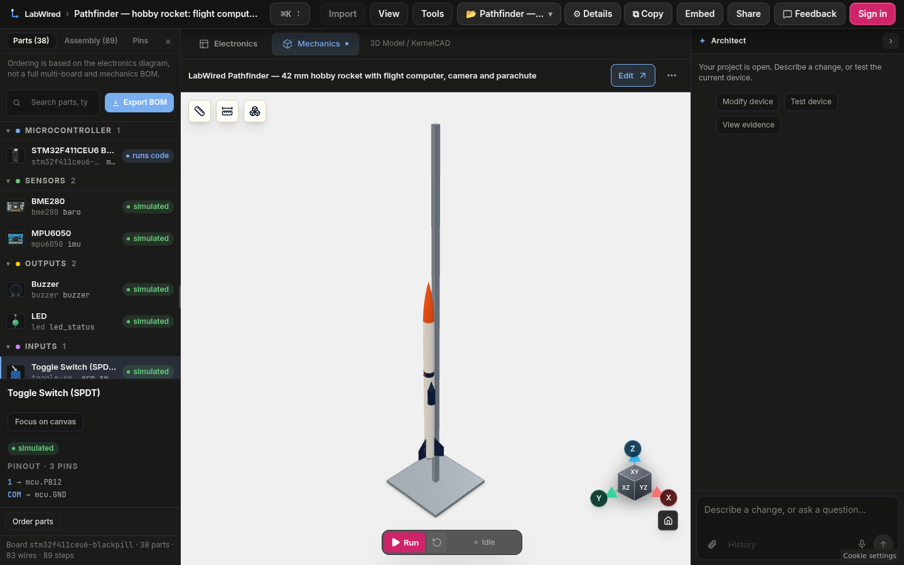

# Pathfinder hobby rocket

This example is exported from a **real saved LabWired project**, not a proposed design.

- [Open the original project in LabWired](https://app.labwired.com/p/c9ede30a619b12d7c97056a2da040cc1/edit)
- [Project source, diagram, stimuli and oracle input](project.input.json)
- [Revision-pinned saved evidence](evidence.json)
- Board: `stm32f411ceu6-blackpill`
- Saved content hash: `2e8fef00dc7123091c40e3079e7d127604d5f5c8bb691da02bcd1a230fd70663`
- Original simulator evidence on this exact revision: **model_verified**
- Individual saved requirement results: **5/5 verified**

The [22 November hosted recheck](../../flagship-hosted-recheck-20261122.json) verifies the current saved revision (`83fc8079ea49d9207f69371e402318393cd9c304df476844a7b72682633d9dd0`) at 20,000,000 simulation steps: **5/5 firmware oracles passed**, after the 4,000,000-step run stopped before landing. The project input and `evidence.json` below remain immutable receipts of the earlier `2e8fef00...` revision; they are not silently replaced with the current bytes. PCB-to-CAD fit remains **rejected**.

## Reproduce

1. Inspect `project.input.json`, which contains the original editable firmware source, circuit/netlist, input stimuli and explicit verification requirements.
2. Use LabWired's `labwired_project_create` with the input fields, or open the original saved project above. The imported copy is **unlisted**, and it does not automatically inherit a PCB, CAD attachment or verification receipt.
3. Run `labwired_project_verify` against the copied project with the saved requirements. Inspect the returned exact content hash and all clause results. Do not treat compilation alone as verified.
4. Inspect PCB and mechanical artifacts separately in the original project; record a fresh verification when changing firmware, wiring, source, or CAD identity.

## Proven boundary

Firmware phase transitions and saved simulated pressure/acceleration cases are verified; firmware-to-flight dynamics, fabrication, PCB fit and physical flight are not. This is the hobby-rocket showcase, not OLGA.

The linked PCB/CAD items, if present, are **not** reconstructed by the project-input import. The `evidence.json` file is a readback of the original saved project on 2026-11-21, not a promise that any future deployment or new copy has passed.

## Pinned PCB-to-CAD geometry rejection

The source-bound [pad fixture](pcb-cad-fit-negative.json) was read from LabWired PCB `pcb_e2ec5d2f4ade4aac`, revision 1 (38 parts, 152 pad centers). KernelCAD `K_DmeiaD`, immutable revision 2, declares a 38.4 mm coupler inner diameter and a 32 mm sled.

[The executable negative-control check](../../../scripts/check-pathfinder-fit.mjs) computes the minimum projected width of all pad centers over every in-plane board rotation: **50.896 mm**. This exceeds the 38.4 mm coupler ID, even before adding pad sizes, board edge and clearance. The board **cannot fit** this CAD assembly. The test passing means this known incompatibility is correctly detected; it does **not** mean the rocket has passed PCB/CAD fit.

A future design must revise the physical PCB placement/partition and native board, or intentionally change the airframe and rerun stability/mass/fit analyses. The current 42 mm airframe has no accepted avionics-board fit.

## Live Studio screenshot — 21 November 2026

[Source-pinned live screenshot and independent verification scope](../../flagship-live-snapshots-20261121.json). Static CAD rocket visualization. Pinned PCB pcb_e2ec5d2f4ade4aac@1 fails fit against KernelCAD K_DmeiaD@2 (min pad-center width 50.896 mm vs 38.4 mm coupler ID). No fabrication or physical flight proof.
