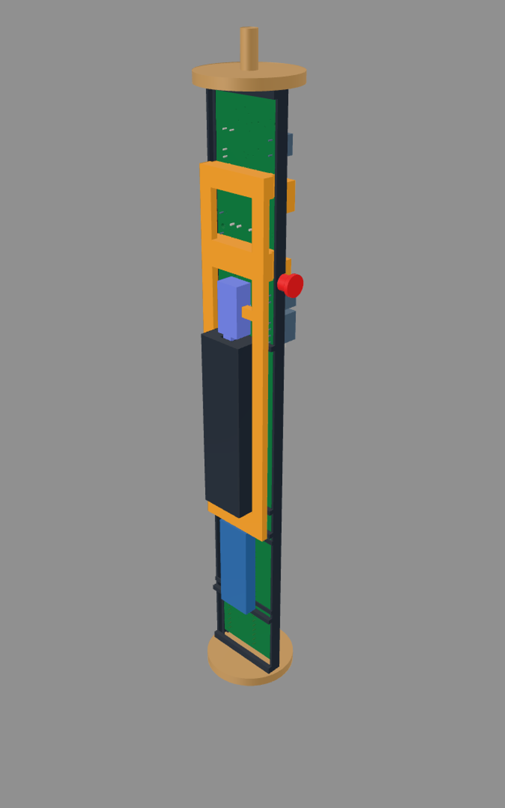

# Pathfinder: sourced carrier and extended avionics bay

This separate bench candidate passes nominal PCB/CAD fit, final native KiCad DRC, and local source-to-copper compiler parity. The saved project exists with exact PCB/CAD bindings. Fresh hosted project replay on 22 November at 17:36 UTC passes 5/5 saved synthetic firmware requirements at 20,000,000 steps ([immutable receipt](../../../flagship-fresh-hosted-reverify-20261122.json)). This is firmware replay evidence, not physical flight or a PCB-CAD insertion check. Physical assembly, current, thermal and flight acceptance remain open.

The [original example](../README.md), original project, PCB and CAD remain preserved. Its pinned geometry rejection remains valid. This directory does not replace that negative evidence.

## Saved identities

| Item | Exact identity |
| --- | --- |
| Candidate project | [d4de8c2bc6aad00bab720da9e1ff2414](https://app.labwired.com/p/d4de8c2bc6aad00bab720da9e1ff2414/edit) |
| Latest saved project content | `9dedd6609cf6cf3b39e6500823019bb03fc453b21c7bdccd83af67031ea62fb7` |
| Native carrier | `pcb_af828a3152e61e08@0` |
| Native PCB SHA-256 | `0a2355f26284a52bd9dfdae7e4aa2eb68744fecfe07d463cdb6c3cca607e3c93` |
| Native rule reference | `sha256:c7b4df33e64a13bc636c3d9718076504a1146dde8c49e8c13f4bb6b3ebb0c850` |
| Saved CAD | [PuRrQzv1 revision 2](https://app.kernelcad.com/p/PuRrQzv1?version=2&show_electronics=1) |
| Full CAD source SHA-256 | `2d632a78aadd0d2900c4d8bd2aa0fe8834411039cfb3d4f038c222e972b5a3d9` |
| Logical design input SHA-256 | `496440cc518f18dc7c7c9e4c81d8e8179c65ab471a1bd8b453a489afc891aeff` |
| Reviewed local implementation | LabWired `14aa25315b8d4f3db16b69332b88e32413d1094a`, [PR3975](https://github.com/w1ne/labwired/pull/3975), on the source-completion stack |

[project.input.json](project.input.json) contains the editable candidate, firmware, retained input vectors, requirements and native board binding. [project-source-selection-update-receipt.json](project-source-selection-update-receipt.json) records the final content-hash compare-and-swap and independent readback. It confirms preservation of firmware, stimuli, requirements and unrelated project fields. The carrier has 37 explicit source-to-native bindings. The battery, converter, panel switch and bench load have separate offboard catalog instances, giving 41 device parts.

## What passed

| Check | Result and scope | Receipt |
| --- | --- | --- |
| Native import and explicit assembly | 37 mapped, 0 dropped, 0 ignored; exact manufacturer/package/pad evidence, including unused pads | [Local native binding](routing/native-assembly-after-importer-fix-local.json) |
| Physical copper model | Zero copper connectivity findings. Source, explicit assembly and extracted copper compile to byte-identical system YAML `39054d3a…b037`, with parasitics disabled | [Local circuit parity](routing/native-circuit-parity-local.json) |
| Firmware compilation | Retained STM32F411 Arduino firmware compiles; artifact `sha256:320d6615…26d3` | [Compile receipt](compile-receipt.json) |
| Hosted native DRC | KiCad 10.0.8: zero errors, warnings and open connections. Schematic parity was not checked by this DRC operation | [Hosted DRC](routing/hosted-drc.json), [export ZIP](routing/pathfinder-native-drc-export.zip) |
| Independent local DRC | Zero geometric errors, unconnected items and net-class dimension violations. Exit **5** records 37 library-availability warnings | [Final-file DRC](routing/route-drc-summary.json) |
| Actual copper dimensions | 580 tracks and 65 vias; all declared width/drill/diameter minima pass; native pad geometry/net assignment matches the unrouted source | [Copper audit](routing/actual-copper-audit.json) |
| Static bay fit | Source-bound component envelopes pass the hosted design loop. Minimum component radial clearance is 1.120525 mm | [CAD checks](final-bay-cad-checks.json), [fit envelopes](fit-envelope.json) |
| Nominal assembly path | All 161 checked moving bounds fit within an R18.4 mm cassette. Axial translation through the constant R19 mm bore is clear under the stated removal/disconnection steps | [Containment proof](assembly-envelope-proof.json), [bounded path](assembly-path-bounded.json) |
| Saved CAD delivery | Immutable source readback matches. Mesh is ready. Stored API and public Node download return the same 4,659,194 bytes and 66 features | [Artifact readiness](cad-artifact-readiness.json) |

The exact ready CAD mesh is archived as [deterministic gzip](cad-artifact-20261122/mesh.json.gz). It decompresses to 4,659,194 bytes with SHA-256 `c5c78d0f0c81dc26833aec7f0d7b4c8e7dfae7dd3d8a0c9e97124634d8c1f0e6`. The [archive receipt](cad-artifact-20261122/archive.json) binds the gzip bytes, producer identity, original ready project response and immutable revision source readback. This preserves the baseline from before the generic mesh-producer update.

On 2026-11-22, the deployed producer `fd52f2c20b801c8a7ab875ebeb6b844a928baf97` / runtime `f00d5beda7bb1f5befa8f001329013b0c2b1e6b9ae85019837415deee2d89977` returned a ready artifact for the same saved revision. The [post-deployment comparison](cad-artifact-refresh-20261122/comparison.json) passes with **zero changed features or faces** across all 66 features and 1,074 faces. It excludes only top-level producer provenance; it preserves every other field, array order, numeric value and negative zero. Both actual asset manifests and both API/CDN provenance URL pins match the artifact. Default Node downloads returned identical 4,659,194-byte bodies with SHA-256 `aac0e9745afb76049b8537c67e28a9a8a1ef0dc7206b248c8b00b154aa472e09`.

The [new deterministic archive](cad-artifact-refresh-20261122/archive.json) retains those exact bytes, source readbacks and download results. The [comparison script](compare-cad-artifacts.mjs) reproduces the result locally. Its nine [control cases](cad-artifact-refresh-20261122/comparator-controls.json) accept the archived baseline and reject changed geometry/normals, wrong runtime/source/assets, and stale URL provenance pins. No source save or explicit remesh operation was performed. Interactive viewer paint remains unobserved.

These checks have separate meanings. DRC does not establish logical circuit parity. Compiler parity does not model measured analog loads. A ready mesh does not establish that the interactive viewer painted it. Nominal geometric clearance does not establish a manufacturable tolerance stack.

The original Freerouting log reports one unrouted item and 13 internal violations. That observation is retained. Independent KiCad DRC and physical copper extraction are the acceptance checks on the imported final native board. The router log is not described as a pass.

## Physical design correction

All 38 original functional parts remain. Three explicit harness interfaces replace ambiguous on-board stand-ins, producing 37 carrier parts and four offboard parts. The correction uses an actual 44-pad WeAct module package, sourced sensor/storage modules, correct transistor packages and rated terminal bodies. It preserves circuit values and firmware timing.

| Dimension or reserve | Candidate |
| --- | --- |
| Carrier PCB | 31.5 × 235 × 1.6 mm |
| Carrier frame | 242 mm long, bounded by radius 18.4 mm |
| Avionics coupler | 250 mm long; 38 mm nominal bore; 39.6 mm outside diameter |
| Existing external airframe | 42 mm outside diameter |
| Nominal frame-to-bore radial gap | 0.6 mm |
| PCB rail channel | 32.1 × 2.1 mm; nominal 0.3 mm lateral clearance per side and 0.5 mm upper clearance |
| PCB axial range | z = 237.5…472.5 mm |
| Coupler axial range | z = 230…480 mm |
| Motor-mount separation | 110 mm nominal, from motor-mount end to lower eyelet envelope |
| Battery maximum published body envelope | 66 × 17 × 9.5 mm, including the manufacturer's positive dimensional tolerances |
| Battery installation reserve | 68 × 18 × 10.5 mm, plus a separate connector/cable service volume |

The original wide board cannot pass the original 38.4 mm bore. This candidate uses a narrow board and a longer internal bay, with explicit axial clearance in the full airframe. It does not enlarge the 42 mm external airframe to conceal an oversized board.

The PCB tolerance allowance remains a physical hold. With the cited board outline tolerance of ±0.2 mm and thickness tolerance of ±10%, the nominal channel leaves 0.4 mm total lateral allowance and 0.34 mm vertical allowance before carrier printing error. Measure the actual board, print, bore and battery before assembly. The tray's lower corners are clipped to R18.4 without reducing the battery reservation.

The [drill review](pcb-cad-drill-parity-review.json) matches all 173 holes/cutouts one-to-one: 100 pad holes, eight wire cutouts and 65 vias. Ten terminal-hole centers differ by at most **0.0005 mm** because of CAD emission rounding. Exact coordinate equality is not claimed.



The saved revision uses documented occupied envelopes. The separate `pathfinder-vendor-step.kcad.ts` and `avionics-fit-vendor-step.kcad.ts` files retain the vendor STEP reference variant. Exact multi-solid STEP geometry and bounded-envelope receipts have different source hashes and are not interchangeable. The accepted fit and insertion results above refer to the bounded sources.

## Parts and source provenance

[source-parts.json](source-parts.json) records all 41 selections, 22 distinct selected manufacturer records, canonical physical pad mappings and primary references from the reviewed source checkout. [source-provenance.json](source-provenance.json) pins the app commits, stock KiCad tree and manufacturer footprint manifest. Per-part body-envelope bases and URLs are retained in [fit-envelope.json](fit-envelope.json).

The sourced records include WeAct MiniSTM32F411; Adafruit BME280, MPU6050 and microSD 4682 modules; AO3400A/AO3401A in SOT-23; Nexperia MMBT3904 with B/E/C pad order; selected Nichicon capacitors; Yageo 0603 resistors; Kingbright WP7113GD; and Phoenix 1984617/1984633 terminals. The offboard boost is Pololu U3V70F5. The provisional battery is Tattu TAA4501S75BT2.

Of the 37 carrier envelopes, 31 have a datasheet/source basis, five remain estimated, and one is an explicit assumption. C4, D2, the camera/UART/arm headers and the TVS envelope still require actual part/assembly confirmation. The generic battery source symbol is a simulation interface; the physical battery selection is documented by the battery receipt. It is not a barrel-jack hardware claim.

The native identity correction changed Q2's value to AO3400A and Q4/Q5 to MMBT3904, and added source/pin metadata. Every footprint, pad, net, track, via and outline coordinate stayed identical. The [identity receipt](routing/native-identity-correction.json) records that comparison. A later [source metadata correction](source-selection-correction.json) removed J5's stale generic `1x04` override; the complete resolved netlist stayed identical.

## Wiring access and electrical limits

The Phoenix terminal bodies include their 9.15 mm installed height and solder tails. Eight 2.4 mm holes reserve protected wire passages. The wire model uses nominal 1.6 mm outer diameter and a 1.8 mm reserve for the selected 22 AWG wire. The 5.5 mm bend space is an assembly assumption, not a published minimum bend radius. Screwdriver access requires removal of the coupler and support of the terminal bodies during tightening.

For axial installation, remove both bay bulkheads and the radial panel switch, disconnect external leads, and assemble the populated PCB into the carrier before connecting the reserved harness. The full 48-body assembly solver exceeded its search budget on the preceding geometry; [that unknown result](assembly-path-full-budget.json) is retained separately. The accepted result is the bounded axial path with explicit containment and preconditions.

The **1.5 Ω load is external bench equipment**. At an ideal 4.35 V it draws 2.90 A and dissipates 12.615 W. The unchanged 1000 ms pulse corresponds to 12.615 J before losses and tolerance. It is not assembled as a generic 0603 resistor and is not a flight initiator specification.

The [battery/current review](battery-current-review.json) preserves the full budget. The selected battery is 1S LiHV, 3.8 V nominal and 4.35 V maximum. Its nominal cell C-rating does not qualify the pack or harness. The BT2.0 interface is initially limited by its cited 9 A continuous connector rating, while actual wire, joint and connector behavior remains unmeasured. A 1 A load at 5 V and assumed 75% boost efficiency already gives about 4.43 A battery current at 4.35 V, before auxiliary loads and tolerances.

The native classes use 1.8 mm for VBAT/common ground, 1.0 mm for the switched bench return, 0.6 mm for 5 V and 0.5 mm for 3.3 V. [Actual-copper measurements](routing/actual-copper-audit.json) retain every path length, minimum width and via transition. Resistance estimates assume nominal 0.07 mm copper, a 20% width reduction and 0.018 mm via plating. These are declared assumptions, not guaranteed fabrication minima.

The three PCB portions of the 2.90 A bench branch give an estimated 89.34 mV total drop under those single-path assumptions. This excludes pad spreading, MOSFET package/channel, solder, contacts, cable, connector resistance and concurrent shared-current heating. The SOT-23 pad regions, power vias, camera peak current, voltage sag and thermal rise require measurement. Buzzer impedance/current remains an explicit model warning.

## Mass and flight scope

The [mass/stability review](mass-stability-review.json) is bound to the final CAD and PCB. The 17 nominal CAD solids total 242.082458 g under their declared material densities. Removing attachment rod stand-ins gives a **241.640248 g material estimate**, with axial centroid z = 351.876357 mm. This is not complete flight mass or measured CG.

All 69 rows in [mass-inputs.template.json](mass-inputs.template.json) remain unmeasured. Forty-six purchased bodies, service envelopes and hardware require separate accounting. The axisymmetric body/fin Barrowman reference gives CP at z = 213.204704 mm. It excludes the asymmetric camera-pod effect, so full-airframe stability remains unaccepted. The original 351 g mass and 364 m trajectory claims do not apply to this revised candidate.

The firmware requirements retain the original pressure/acceleration replay and assertions. Passing those vectors demonstrates controller behavior for those inputs. It does not predict the revised airframe's trajectory.

## Reproduce the evidence

Run the repository receipt checks without hardware tools:

```sh
node scripts/check-pathfinder-candidate.mjs
node scripts/check-pathfinder-fit.mjs
python3 examples/aerospace/pathfinder-rocket/candidate/check-assembly-envelope.py
python3 -m unittest discover -s examples/aerospace/pathfinder-rocket/candidate -p 'test_mass_input_validation.py' -v
```

For local native identity/copper/compiler parity, check out the exact LabWired implementation in `source-provenance.json`, install its pinned dependencies and build `packages/board-config` and `packages/board-pcb`. Then run:

```sh
LABWIRED_CHECKOUT=/path/to/labwired /path/to/labwired/node_modules/.bin/tsx examples/aerospace/pathfinder-rocket/candidate/routing/verify-native-circuit.mts
```

The script requires the recorded implementation commit and a clean tracked source tree. It regenerates the local native binding, compiler parity and source-record receipts. The PCB SHA must remain exact.

With KiCad 10.0.8 and its Python `pcbnew` module installed:

```sh
python3 examples/aerospace/pathfinder-rocket/candidate/routing/verify-final-board.py
python3 examples/aerospace/pathfinder-rocket/candidate/routing/audit-copper.py
```

The final-board script preserves both rule files byte-for-byte and records KiCad's real exit code. Historical placement/routing inputs and failed attempts remain in `history/` and `routing/history/`; they are not current acceptance evidence. Regenerating placement or routing creates a new physical candidate and requires new CAD, DRC, copper and provenance checks.

After the source/importer and saved per-board lookup stack is deployed, rerun `labwired_project_verify` on the same saved candidate and record its exact content hash and clause results. Do not copy the original project's verification receipt onto this candidate. Physical fabrication, assembly, current/thermal and flight holds remain separate even after a software replay pass.
