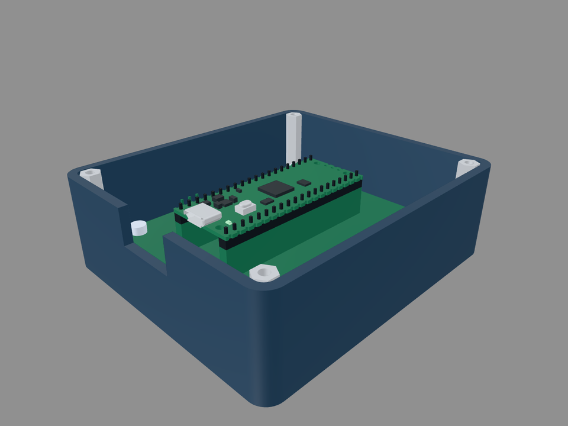

# Raspberry Pi Pico UART fixture — revision A

This package turns the featured Pico example into a buildable USB-powered bench fixture. It contains a routed 60 × 70 mm carrier, a Raspberry Pi Pico SC0915 with specified Samtec headers, a fitted two-piece case, bootable Arduino Mbed firmware, a bill of materials, fabrication files, and verification receipts.

[Canonical LabWired project](https://app.labwired.com/?lab=rp2040-pico) · [Acceptance issue #3553](https://github.com/w1ne/labwired/issues/3553) · [Featured-project tracker #3547](https://github.com/w1ne/labwired/issues/3547)

The firmware prints the boot banner and toggles the Pico's actual GP25 LED. The console is UART0 on GP0/GP1 at 115200 baud, 8 data bits, no parity, one stop bit. The physical console uses an Adafruit 954 USB-to-TTL adapter. The Pico's micro-USB port supplies power and accepts the UF2 image.

## Qualification

| Check | Recorded result | Evidence |
| --- | --- | --- |
| Native KiCad 10.0.8 schematic | 0 ERC violations | [ERC report](validation/erc.json) |
| Routed two-layer board | 0 DRC violations, 0 unconnected items, 0 schematic-parity issues | [DRC report](validation/drc.json) |
| Independent hosted native validation | Exact bytes preserved; KiCad10.0.8 reports0 errors and0 warnings | [Hosted DRC](validation/native-import-validation.json) |
| Released hosted firmware | All 5 oracle clauses passed; GP0 made 181 transitions and GP25 made 2 transitions before the gate stopped | [Model-verification receipt](validation/firmware-model-verify.json) |
| Local pinned SDK build | Build succeeded; the same 5 behavior assertions passed over 50,000,000 interpreted steps | [Local build acceptance](validation/local-build-acceptance.json) |
| Nominal case fit | All 5 dimensional requirements passed | [CAD evaluation](validation/cad-evaluation.json) |
| Design review | Accepted: functional and quality checks passed, seven visual checks recorded; one source-count style heuristic explicitly reviewed | [Design loop](validation/design-loop.json) |
| Assembly STEP | Export passed; all 50 re-imported solids are valid | [STEP inspection](validation/assembly-step-inspection.json) |
| Printed parts | Base and lid STL exports passed with verification enabled | [Base](validation/base-stl-export.json), [lid](validation/lid-stl-export.json) |
| Assembly-path sequence | The initial full-scene computation exhausted its work budget; it is inconclusive | [Recorded result](validation/assembly-path-budget.json) |
| Physical qualification | No fabricated board, printed case, cable measurement, powered test, or assembly test has been recorded | [Bring-up procedure](ASSEMBLY.md) |

Model verification proves the listed behavior in the RP2040 model. The model assumes an ideal supply and derives time from a 125 MHz clock without tracking PLL reconfiguration. The oracle therefore checks serial content and pad transitions; it does not certify physical baud error, LED frequency, USB enumeration, power-on reset, or brown-out behavior.

## Package contents

- [Native KiCad project](electronics/pico-carrier.kicad_pro), [schematic](electronics/pico-carrier.kicad_sch), [routed PCB](electronics/pico-carrier.kicad_pcb), and project-local symbol/footprint libraries.
- [Readable schematic PDF](manufacturing/pico-carrier-schematic.pdf), [fabrication ZIP](manufacturing/pico-carrier-fabrication.zip), and [fabrication settings](manufacturing/fabrication-settings.json).
- [Full bill of materials](bom.csv), [electronic parts](electronics-bom.csv), and [mechanical/electrical interface](hardware-interface.json).
- [Editable enclosure source](mechanical/pico-uart-fixture.kcad.ts), [assembly STEP](mechanical/pico-uart-fixture.step), [base STL](mechanical/pico-uart-base.stl), and [lid STL](mechanical/pico-uart-lid.stl).
- [Arduino source](firmware/src/main.ino), [pinned build configuration](firmware/platformio.ini), [ELF](firmware/artifacts/pico-uart.elf), [UF2](firmware/artifacts/pico-uart.uf2), and [build manifest](firmware/release-manifest.json).
- [Assembly and bring-up instructions](ASSEMBLY.md), [source notices](THIRD_PARTY_NOTICES.txt), and [release hashes](SHA256SUMS).



## Electrical contract

Use the plain Raspberry Pi Pico SC0915. Solder two Samtec TSW-120-07-G-S headers into it. The specified Samtec SSW-120-01-G-S sockets establish an 11.05 mm nominal gap between the carrier's upper surface and the Pico PCB underside. A factory-header Pico H has an unspecified header stack in this package; its firmware is compatible, but its mechanical fit is not the released stack.

The carrier routes three nets: GND, UART_TX_GP0, and UART_RX_GP1. It does not distribute VBUS, VSYS, or 3V3. Power the Pico through its micro-USB connector. Leave the adapter's red 5 V lead disconnected and insulated.

| Carrier contact | Pico contact | Signal | Adafruit 954 lead |
| --- | --- | --- | --- |
| J3 pin 1 | GND through J1/J2 | Common reference | Black, GND |
| J3 pin 2 | Physical pin 1, GP0 | Pico UART0 TX | White, adapter RX |
| J3 pin 3 | Physical pin 2, GP1 | Pico UART0 RX | Green, adapter TX |
| No carrier contact | No connection | Adapter 5 V | Red: disconnected |

J3 pin 1 is the square pad. With USB at the top of the carrier, its contacts run downwards: GND, TX, RX. The pin numbers in the native schematic and PCB are authoritative.

J1 pins 1–20 mate Pico physical pins 1–20. J2 pins 1–20 mate Pico physical pins 40–21 in reverse numerical order. Both carrier socket pin-1 ends face the USB end. The connected grounds are J1 pins 3/8/13/18 and J2 pins 3/8/13/18; J2 pin 8 is Pico AGND. All other socket contacts are intentionally isolated. TP1 is GND, TP2 is TX, and TP3 is RX.

The released firmware transmits on GP0. GP1 is routed and available for later firmware; the present oracle does not claim a receive/echo test.

## Firmware

The released ELF SHA-256 is:

324a84cbb18276a4814bc4ecf7a20c8b7117ebe874d0df86952ea029dc84bce3

It was compiled by the existing hosted rpi-pico Arduino profile. Its image contains the RP2040 second-stage bootloader at 0x10000000 and the application after the 256-byte boot2 area. The UF2 is converted from this exact ELF for the RP2040 family.

This fixes a material packaging gap in the old simulator-only smoke program. That regression fixture remains in labwired-core as a baseline. This package uses the SDK's real clock, UART, GPIO and boot setup and operates GP25 through the Pico board definition.

To rebuild locally, install PlatformIO Core 6.2.0 and run from this package directory:

```sh
pio run --project-dir firmware --environment pico
```

The configuration pins platformio/raspberrypi 1.20.0, Arduino Mbed 4.6.0, GCC Arm Embedded package 1.90201.191206, and RP2040 tools 1.0.2. The output files are firmware/.pio/build/pico/firmware.elf and firmware.uf2.

The hosted artifact and local rebuild have different linked bytes. Both passed the same five behavior assertions. This package records both hashes; it does not claim that local builds are bit-identical to the hosted compiler image. Use the released ELF/UF2 together when reproducing the published oracle, or qualify a local rebuild using the same oracle.

To flash the released UF2:

1. Disconnect both USB cables.
2. Remove the lid to reach BOOTSEL.
3. Hold BOOTSEL while connecting the Pico micro-USB cable.
4. Copy firmware/artifacts/pico-uart.uf2 to the RPI-RP2 mass-storage device.
5. Reconnect the USB-to-TTL adapter and open its serial port at 115200 8N1. Reset or reconnect the Pico after the terminal is open to capture the boot banner.

Expected output begins with RP2040_SMOKE_OK. PICO_LED=1 and PICO_LED=0 then alternate. The source requests 100 ms in each LED state. The UART remains observable with the case closed. Inspect the physical LED with the lid removed; the released opaque lid covers it.

## Mechanical contract

The enclosure envelope is 78 × 88 × 32 mm including the upper screw heads. Its printed base is 27.5 mm high with a 2.5 mm floor and walls. The lid has a 2 mm plate and three 1.2 mm registration tabs. Four carrier and four lid standoffs attach through countersunk holes in the base.

The carrier underside is at Z=8 mm. The module PCB underside is at Z=20.65 mm. Its USB faces the open-top notch at the front of the case. The measured minimum Pico-to-lid clearance is 3.12 mm. A declared 16 × 8 mm USB plug envelope has 1.0 mm clearance to the base and 0.735 mm clearance to the lid. Adafruit does not publish the selected cable's overmold dimensions; this is an envelope check, and the received cable must be measured during bring-up.

The 10 × 14 mm lid opening accepts the three individual UART housings. Fit the leads before fitting the lid and leave a service loop. A 2.5 mm Panduit cable tie passes through the two 3.2 × 7 mm slots. The red power lead stays outside the enclosure.

The manufacturer STEP is preserved byte for byte. All 17 native solids remain separate fixed components, including the USB shell elements. The case source adds the specified headers and hardware around them. It does not replace the Pico with a block or fabricate joining material between the vendor's bodies.

## Reproduce the checks

Open the native project with KiCad 10. Run ERC on the schematic, then run PCB DRC with schematic parity enabled. The commands and exact fabrication outputs are recorded in [manufacturing/reproduce.txt](manufacturing/reproduce.txt). The copper is already routed; rerunning the checks does not require an autorouter.

The [behavioral oracle](validation/behavioral-oracle.json) uses the mandatory LabWired verify operation with the released firmware reference and [circuit](labwired/circuit.json). For native CLI reproduction, use labwired-cli v0.26.0 and the RP2040 system from the pinned labwired-core revision in [validation/reproduce.txt](validation/reproduce.txt).

The editable CAD file loads two source-relative STEP files from this package. The submitted hosted source uses pinned HTTPS references to those same bytes. The output parameter selects assembly, base-print, or lid-print. The released STLs already have their print orientation.

The next physical action is to fabricate one carrier, print one base/lid pair, and complete the recorded assembly and electrical bring-up procedure. Release qualification stays explicit until those measurements exist.

The current CAD source supersedes the preliminary Studio revision1. A Samtec drawing review corrected the SSW-120 socket body to 2.41 mm REF width and 51.31 ±0.25 mm length. The refreshed assembly STEP contains 50 valid BREP solids; the corrected source passes all five fit requirements. The earlier full design-loop receipt remains historical; base and lid print geometry is unchanged. See validation/connector-dimension-correction.json. Updating that existing Studio project is still pending because its collaboration path does not support imported STEP assets. No replacement project has been created.
