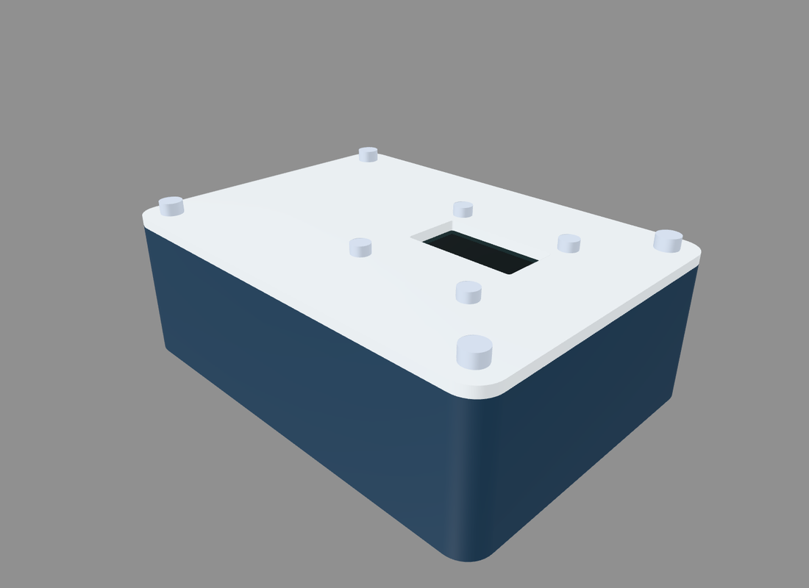

# ESP32-C3 OLED device — Rev A candidate 3

This package contains a USB-powered OLED counter, its routed carrier PCB, firmware, enclosure CAD, assembly instructions and verification evidence. A Seeed XIAO ESP32C3 drives an Adafruit 326 STEMMA QT display. The counter starts at **19:00:00 after every reset** and advances once per second. It has no real-time clock, time-setting control or saved time.

**Status: engineering assembly candidate.** The corrected model retains the native PCB populated side at +Z and uses world Y = −editor Y. All **12/12** fit and registration checks pass. All **18 native drilled pads** match their STEP axes with zero XY error. The glass/support clearance remains **1.277 mm**, with **0.85 mm** support arms and the unchanged **0.8 mm** minimum-wall gate. Both printed parts pass DFM and closed-mesh checks; all **41/41** assembly STEP solids are valid. A fresh independent check passes **39 ordered geometric stages** for all 41 source parts and all 13 helper controls. Hosted assembly-path acceptance and physical qualification remain open. No physical prototype has been built.

The previous source reconstructed the populated assembly in the PCB editor's downward-Y frame. Rotating only the bare substrate hid that reflection. Candidate 3 corrects the primitive geometry, connector frames, print orientations and exported files. The earlier candidate releases remain immutable. Studio revision 2 is historical; saving the corrected source in that same project is pending.

[Open the canonical Lab](https://app.labwired.com/?lab=esp32c3-oled-lab) · [Historical Studio revision 2](https://app.kernelcad.com/p/t_IaE1EE?version=2) · [Track remaining work](https://github.com/w1ne/labwired/issues/3550)

The canonical Lab integration is delivered by the associated platform change. Until that change deploys, the public Lab can still show the previous Super Mini starter. This repository and the release files identify the candidate independently of deployment.



## Package contents

| File or folder | Use |
| --- | --- |
| [bom.csv](bom.csv) | Complete electronics and enclosure BOM, with scoped assembly references and quantities |
| [electronics/oled-carrier.kicad_pro](electronics/oled-carrier.kicad_pro) | Editable KiCad 10 project; keep the entire `electronics/` folder with its rules and libraries |
| [manufacturing/oled-carrier-fabrication.zip](manufacturing/oled-carrier-fabrication.zip) | Gerbers, plated/non-plated drills, drill maps and fabrication settings |
| [manufacturing/oled-carrier-schematic.pdf](manufacturing/oled-carrier-schematic.pdf) | Readable schematic |
| [firmware/platformio.ini](firmware/platformio.ini) | Pinned XIAO build and separate address-scanner environment |
| [firmware/release-manifest.json](firmware/release-manifest.json) | Exact public ELF, merged flash, startup snapshot and ROM identities |
| [labwired/circuit.json](labwired/circuit.json) | The actual functional starter diagram exported from the platform implementation |
| [cad/esp32c3-oled-enclosure.kcad.ts](cad/esp32c3-oled-enclosure.kcad.ts) | Editable, parameterized KernelCAD source |
| [cad/exports/](cad/exports/) | Assembly STEP and separate base/lid STEP, STL and 3MF files |
| [cad/assembly.txt](cad/assembly.txt) | Print orientation, hardware stack, assembly sequence and fit checks |
| [release-manifest.json](release-manifest.json) | Package identity and file integrity manifest |
| [verification/](verification/) | Observed firmware results, build provenance and reproducible checks |

The complete package includes the `.kicad_dru` fastener keepouts, local symbol/footprint libraries and mechanical component assets. The Lab's native viewer downloads the `.kicad_pcb`, `.kicad_sch` and `.kicad_pro` for inspection; use the complete package for editing or fabrication.

## Electrical design

The carrier is **70 × 45 × 1.6 mm**, with two copper layers and four 2.9 mm non-plated mounting holes. It contains two XIAO sockets, a JST SH cable connector and two 4.7 kΩ pull-ups. The XIAO and OLED are purchased modules; their internal boards are not part of the carrier Gerbers.

| Signal | Controller | Carrier connector | Display |
| --- | --- | --- | --- |
| SDA | D2 / GPIO4, J2.3 | J1.3 | STEMMA QT SDA |
| SCL | D3 / GPIO5, J2.4 | J1.4 | STEMMA QT SCL |
| Power | 3V3, J3.5 | J1.2 | STEMMA QT VCC |
| Ground | GND, J3.6 | J1.1 | STEMMA QT GND |

GPIO4/5 are explicit firmware assignments. The XIAO's usual D4/D5 I²C labels refer to different GPIOs. Use the table above.

Use the **Adafruit 326 STEMMA QT revision**. Close **SJ3 / ADDR** to select `0x3C`; its open/default address is `0x3D`. Keep the factory I²C jumpers SJ1/SJ2 closed. Leave the optional eight-pin JP2 header unpopulated. Its physical order is SDA, SCL, DC/SA0, RST, CS, regulated 3.3 V output, Vin and GND.

Use the specified **Samtec BHS-107-G-A / HSS-107-G-2 round-pin pair**. The module tails are 0.46 mm in diameter and fit the XIAO's native 0.85 mm holes. A 0.635 mm square post has a 0.898 mm diagonal and does not fit that hole specification. The nominal mated board gap is 9.77 mm. Substituting a generic header changes both fit and enclosure height.

USB supplies the device. Battery pads and the carrier's VBUS socket contact are unused. The demo does not enable Wi-Fi or Bluetooth; its supplied antenna remains separate. Install the antenna before using firmware that enables RF.

The Lab diagram represents the **MCU/display functional connections**. The native carrier and complete BOM also contain sockets, connectors, pull-ups and mounting features. The preserve import of the carrier is an identity/geometry result and has no runnable MCU model. The firmware tests do not simulate all carrier copper, cable parasitics, analog power or mechanical fit.

## Build and flash

Use PlatformIO Core **6.2.0**. The project pins `espressif32@7.0.1`, the official `seeed_xiao_esp32c3` board and Arduino. Run these commands from this directory:

```sh
pio run -d firmware -e clock
pio run -d firmware -e i2c_scan
```

Both environments were built successfully. The tested clock application uses **271,678 bytes of flash** and **15,140 bytes of RAM** in this toolchain. The unchanged workshop sketch is mirrored from core commit `941a6c5caf0c53b66aa5af9290e5ecba5972ec72`; [source-provenance.json](firmware/source-provenance.json) records its path and SHA256.

For initial assembly, connect a USB-C **data** cable with the lid removed. Select the actual serial port when more than one board is connected:

```sh
pio run -d firmware -e i2c_scan -t upload --upload-port /dev/ttyACM0
pio device monitor -d firmware -e i2c_scan --port /dev/ttyACM0
```

The scanner must report `I2C_ACK 0x3C`. Stop the monitor, then upload the clock:

```sh
pio run -d firmware -e clock -t upload --upload-port /dev/ttyACM0
pio device monitor -d firmware -e clock --port /dev/ttyACM0
```

Confirm visible changes and serial lines `WORKSHOP_TICK 19:00:00`, then `WORKSHOP_TICK 19:00:01`. If automatic USB download entry is unavailable, hold BOOT, press and release RESET, then release BOOT and retry upload. Keep both buttons accessible until bring-up is complete.

The public runtime is [firmware-demos-v19](https://github.com/w1ne/labwired-core/releases/tag/firmware-demos-v19). Its ELF, merged flash and startup snapshot are a matched set. The startup snapshot was captured through real ROM boot from those exact bytes. The separate package build uses the same sketch and has a different ELF hash. Project paths can change ELF bytes. No byte-identical rebuild claim is made.

[verification/reproduce.txt](verification/reproduce.txt) downloads and checks the public runtime and runs the existing LabWired CLI against the packaged configuration. It also describes the standalone-build ROM-boot check. The package does not add a simulator or a custom device model.

## Assemble the candidate

1. Follow [electronics/assembly-notes.txt](electronics/assembly-notes.txt). Populate the five carrier components, fit the round-pin headers and inspect every joint. Check the four signal continuities and absence of a 3V3/GND short before connecting USB.
2. Configure the OLED for `0x3C`. Connect the **Adafruit 4210 100 mm** STEMMA QT cable. Run the scanner and clock with the assembly open.
3. Print the base and lid from their separate exports. Use the orientations and starting PETG settings in [cad/assembly.txt](cad/assembly.txt). Print checks are geometric checks; no printed sample has been measured.
4. Install the four 5 mm carrier spacers, four 25 mm lid spacers, washers and exact screw lengths from the BOM. Mount the OLED to the removed lid with the specified M2 hardware and **Wera 2069 05118120001**4 mm nut driver (5.7 mm outer blade diameter). Route the cable through the documented service space.
5. Confirm all fit checks below before closing. The lid must seat without bowing, cable compression or load on the OLED glass.
6. Check USB insertion, clock updates, reset behavior and repeated lid removal. Record actual module revision, printed dimensions, cable identity and measured clearances in issue [#3550](https://github.com/w1ne/labwired/issues/3550).

### Open physical-fit checks

- **Glass/support clearance:** the two open supports beside the glass now provide **1.277 mm nominal clearance**. They retain the original M2 screw positions and **0.85 mm arms/back**. The measured lid minimum wall is **0.8498 mm**, above the unchanged **0.8 mm** limit. The old round supports fail the new 1.0 mm nominal clearance gate at 0.277 mm; the negative-control receipt is included. Measure the received OLED and print against the proposed 0.5 mm bench clearance target. This is not a tolerance-qualified physical fit.
- **Vertical glass clearance:** nominally 0.50 mm for the stated 1.80 mm glass/film envelope. Check the actual display and printed lid.
- **USB cable:** the CAD access check uses a 16 × 8 mm plug overmold. The selected cable vendor does not publish overmold dimensions. Check full connector engagement with the actual cable.
- **Cable and short spacer stack:** the flexible cable and mating plug bodies are not fit-verified. The nominal opposing screw-tip gap in the 5 mm spacers is 0.44 mm; verify clamping and absence of screw bottoming.
- **Module revision:** the current native XIAO board is 1.6 mm thick. The older vendor STEP uses 1.0 mm. The assembly records the adaptation and conservative component envelopes; inspect the purchased revision.

## Observed verification

| Check | Observed result | Scope |
| --- | --- | --- |
| KiCad **10.0.8** ERC | **0 violations** | Native schematic, recorded rule configuration |
| KiCad **10.0.8** DRC | **0 violations, 0 unconnected items, 0 parity issues** | Routed carrier; 39 tracks and 7 vias |
| Native preserve import | Exact SHA256 retained | Unattached board; no MCU simulation proof |
| Package-build ROM boot | **5/5 assertions pass**, 300 million steps | Banner, both tick strings, nonblank display region and bounded stop |
| Published runtime + packaged configuration | **5/5 assertions pass**, 300 million steps | Cold boot of exact v19 bytes with the exported Lab system |
| Published runtime + browser WASM | Two distinct nonblank 128×64 frames; **19:00:00 → 19:00:01** | Exact v19 ELF/flash/snapshot and pinned core engine |
| Enclosure solids and print orientations | **41/41 STEP solids valid; base/lid FDM pass; 16/16 fit, registration and tool-clearance requirements pass** | Corrected native-coordinate CAD and configured FDM geometry |
| Independent ordered path check | **39/39 stages pass; all 41 source parts covered** | Current-source continuous mesh/native swept-envelope evidence in [tool-access](cad/verification/tool-access/ordered-path-summary.json); required holds and a shifted-screw negative retained |
| Specified nut driver | **0.150 mm minimum nominal clearance at all four nuts** | Wera 05118120001,1.4 mm engagement,0.2 mm PCB tip gap;5.9 mm,6.2 mm and over-inserted negative controls |
| Hosted assembly-path acceptance | **Open** | Earlier budget/contact receipts remain; independent follow-up does not change the hosted result |
| `design_loop` review | **Pass: functional, quality and screenshot review** | Corrected source, exact native STEP and actual closed/interior/lid-print renders |
| Printed/device prototype | **Not performed** | Electrical measurements, cable fit and physical assembly remain open |

The native reports record four default ignored ERC categories and five default ignored DRC categories. There are no explicit DRC exclusions. See [manufacturing/validation.json](manufacturing/validation.json) for the complete settings and hashes.

The two frame hashes are identical between the separate package-build CLI run and the released-runtime browser WASM run. The complete CLI result is retained as `verification/package-rom-boot-result.json.gz`; the readable observations preserve its source hash. This evidence does not mint a hosted `model_verified` badge.

## Sources and licensing

Manufacturer geometry, datasheets and component attributions are recorded in [electronics/provenance.json](electronics/provenance.json), [hardware-interface.json](hardware-interface.json) and the CAD receipts. The editable carrier and example scripts carry the included [MIT notice](LICENSE). The mirrored firmware carries its original [MIT notice](firmware/LICENSE). KiCad-library and imported manufacturer assets retain their individual notices. Espressif ROM images remain Espressif copyright and are linked from the pinned core source; the example MIT license does not apply to them.

## Native coordinate registration

The electrical interface tables retain KiCad editor coordinates. The CAD uses (X, Y, Z) = (editorX, −editorY, Z up) and keeps the native substrate's +Z side. The imported substrate receives only a positive thickness scale and Z=8 mm translation. Authored primitives enter this frame before boolean construction; purchased fasteners retain rigid transforms.

[Native registration](cad/verification/handedness/native-registration.json) binds the exact PCB, STEP, portable source, submitted source and staged evaluation. It checks all 18 drilled pad centres and an ordered three-pad orientation witness. Three real clearance gauges pass at 0.200 mm; restoring the historical 180° substrate rotation fails all three. The prior [design loop](cad/verification/handedness/design-loop.json) and [print mesh check](cad/verification/handedness/mesh-export-check.json) remain evidence for the manufactured geometry. The tool-only follow-up adds four clearance requirements and a sourced driver; [exact 41-part geometry equivalence](cad/verification/tool-access/geometry-equivalence.json) confirms no manufactured part changed. The current [ordered path proof](cad/verification/tool-access/ordered-path-summary.json) identifies the updated source.

Run `python3 cad/verification/handedness/verify_native_registration.py --kind oled --package .` with the KiCad 10 Python module available. Run `python3 cad/verification/handedness/verify_mesh_exports.py --kind oled --package .` to check the actual STL and 3MF files. These checks establish source and geometric consistency; manufactured tolerances and physical operation remain unqualified.
