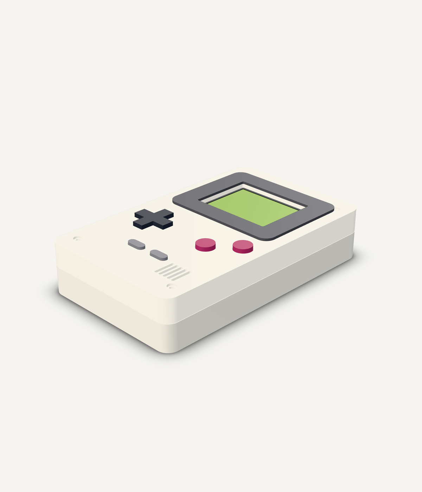

# Game Boy-compatible handheld in LabWired

This example joins an STM32F411 Game Boy emulator, an original playable ROM, a routed carrier PCB, and a revision-pinned KernelCAD enclosure. Peanut-GB executes the ROM's SM83 instructions inside the STM32 firmware. Wire Runner is a 32 KiB original homebrew game. No Nintendo game, boot ROM, logo image, or sound asset is included.

## Open and play

- [LabWired saved project](https://app.labwired.com/?project=f44771855a18a70d418e363622de2e28&run=1)
- [Pinned firmware lab](https://app.labwired.com/?share=aV3vKsFaQjTi&run=1)
- [KernelCAD enclosure, revision 2](https://app.kernelcad.com/p/kQAFdaQs?version=2)

In the LabWired circuit, select **Preview** to operate the on-screen buttons. Let the firmware initialize the display. Hold a direction button to move the chip and collect the diamond. A increases movement speed, B resets the position and score, Start pauses, and Select changes the palette. The project's button `key` attributes are descriptive; global keyboard mappings are not implemented by the generic button component.

The saved project retains the full editable source, exact compiled ELF reference, 10 parts, 24 wires, and the KernelCAD revision and mesh provenance. The generic CAD view, saved-artifact hydration, display geometry, and saved-project verification changes are tracked in the app integration work. Production rollout status is separate from the hardware design results below.




The first image is CAD geometry. The second is a host-emulated ROM frame; it is not a screenshot of the MCU simulation. Live MCU/browser behavior is recorded separately in `firmware/browser-validation.json`.

## What is connected

| Layer | Authoritative artifact | Connection to the other layers |
|---|---|---|
| Firmware and circuit | `firmware/circuit.json`, `firmware/gameboy.c`, pinned ELF reference | MCU pins drive the SPI display and eight active-low controls. Source and ELF references identify the exact tested binary. |
| Physical carrier | `pcb/handheld-carrier.kicad_pcb` | `pcb/simulation-binding.json` maps simulated parts and pins to physical pad numbers. `pcb/carrier-layout.json` records pad coordinates, nets, and the case transform. |
| Shared packaging | `design-interfaces.json` | Both board and enclosure generators read the same outline, mounting holes, display envelope, button positions, and connector assumptions. |
| Enclosure | `mechanical/labwired-gameboy.kcad.ts`, `kernelcad-reference.json` | The saved LabWired diagram pins KernelCAD revision 2 and its mesh provenance. The editable source and validation records are included; generated export binaries are omitted from Git. |

The carrier is 78 × 132 × 1.6 mm. It mounts inside a 90 × 148 × 30 mm shell, with controls increasing overall depth to 32.3 mm. Four 2.8 mm PCB mounting holes use case coordinates x = ±29 mm and y = 16 / 132 mm. Four corner notches clear the case closure posts. The PCB-to-case transform is `case_x = pcb_x - 39` and `case_y = 140 - pcb_y`.

The display is the Waveshare 2.4-inch ILI9341 module with a 70.5 × 43.3 mm PCB and 48.96 × 36.72 mm active area. The carrier uses the WeAct Black Pill v3 physical footprint, an eight-pin JST PH connector for the display cable, eight through-hole switches, and two bypass capacitors. Exact pin assignments and cable order are in `firmware/README.md` and `pcb/simulation-binding.json`.

## Recorded verification

| Check | Result | Evidence |
|---|---|---|
| Hosted firmware compilation | Pass for `stm32f411ceu6-blackpill`, C | `firmware/evidence.json` |
| Firmware model verification | Pass, 50,000,000-step limit; LCD painted; Right input changes the emulated player position | `firmware/evidence.json` → `input_verification` |
| Original ROM behavior | Pass for all eight controls, score collection, pause, palette, and 17,424 scanlines | `firmware/host-validation.json`; host frame in `firmware/frame.png` |
| Live browser display and input | Pass on local source build: 320 × 240 correctly oriented LCD; Right moves player x = 48 to 63; release observed; 0 page errors | `firmware/browser-validation.json` |
| Carrier PCB DRC | 0 violations, 0 unconnected items, KiCad 9.0.2 | `pcb/drc-routed.json` and `pcb/routing-report.json` |
| CAD static design loop | Pass, no detected static interference | `mechanical/evidence-v2.json` |
| Independent fixed-mate review | 15 parts, 14 solved fixed mates, 1 static pose; no detected interference | `mechanical/independent-mates.json` |
| Mechanical export integrity | All 17 exports match byte counts and SHA-256 values; 15 valid STEP solids and 15 watertight STL bodies | `mechanical/download-verification-v2.json` |

The browser display fix propagates the simulator's live width and height into the renderer. It prevents a landscape 320 × 240 ILI9341 buffer from being decoded with a portrait 240 × 320 stride. The app integration includes separate regression tests for display decoding, the simulation host, and the Wasm bridge. Browser evidence is recorded separately as JSON; a painted-display oracle alone does not establish correct browser rendering.

## Scope and material limits

This is a simulated and CAD-checked engineering prototype. No PCB was fabricated, no assembly was fitted, and no physical firmware test was performed. The PCB DRC is not schematic ERC, electrical characterization, or fabrication sign-off.

Power comes from USB through the Black Pill. The top case opening assumes a panel-mounted USB-C extension/pigtail because the module connector is recessed. Battery and speaker bodies are reserved envelopes only. Battery charging, audio, a cartridge connector, removable ROM storage, and save storage are not implemented.

The firmware uses the 16 MHz HSI clock and 4 MHz SPI. Simulation timing follows the MCU model and does not measure real-time game performance. Regulator margin, LCD backlight current, component heights, USB cable clearance, fastener engagement, button travel, soldering access, and assembly sequence remain unverified. The CAD does not include exact Black Pill header, solder-joint, or USB cable solids.

The ROM omits the Nintendo logo header and starts through the emulator's post-boot state. It has not been validated with an original Game Boy boot ROM or a physical cartridge. The included firmware exercises this original ROM; it does not establish compatibility with every commercial game.

The first generic PCB generation returned a 123 × 88 mm placeholder board with an incorrect MCU footprint. That board is detached from the saved project. The accurate KiCad carrier is included here. The existing KiCad import accepts it as design context but cannot automatically derive the runnable twin from the WeAct module and switch footprints. The explicit simulation binding therefore remains the electrical handoff. No automatic round-trip or exact assembled fit is claimed.

## Files and reproduction

`manifest.json` indexes the source, design interfaces, immutable identities and evidence. `firmware/` contains the original ROM, generators, Peanut-GB header, STM32 integration, amalgamated hosted source, circuit, immutable compiled-artifact reference and test evidence. `pcb/` contains the editable KiCad board, DRC, assembly proposal and routing generators. `mechanical/` contains the editable CAD, generator and validation records. Generated ELF, Gerber, drill, STEP, GLB and STL files are omitted from this compact repository contribution. Use the sources to rebuild firmware and regenerate exports; recorded hashes identify the artifacts from the measured runs. The CAD has nine fabrication candidates and six component reference bodies. The reference bodies are not parts to print.

From `firmware/`, run:

```sh
python3 build_rom.py
python3 build_firmware.py
cc -std=c99 -O2 host_verify.c -o /tmp/wire-runner-host-verify
/tmp/wire-runner-host-verify /tmp/wire-runner-frame.ppm
```

### Hosted MCU rebuild and verification

The amalgamated C source is **121,279 bytes**, above the 64 KiB inline compile limit. The verified rebuild path uses the existing MCP source-reference workflow:

1. Call `labwired_put_source` with the contents of `firmware/gameboy.c` as `source` and `entryPath: "src/main.c"`. Keep its returned `source_tree_ref` and per-file refs.
2. Call `labwired_compile` with that `source_tree_ref`, `board: "stm32f411ceu6-blackpill"`, `language: "c"`, and `entryPath: "src/main.c"`. Do not send the large entry inline to compile.
3. Load `firmware/circuit.json`. Call `labwired_verify` with that diagram plus the arguments in `firmware/verification.json`. For an edited rebuild, use the newly returned `firmware_ref` and update the diagram's artifact and source references to the same build.
4. Require `status: "model_verified"`, all three oracle clauses passing, and the Right stimulus reported as applied at cycle 22,000,000. The run limit is 50,000,000 MCU steps.

This does not depend on a browser inline rebuild of the large C file. The host check above tests the cartridge through Peanut-GB; the hosted check tests the compiled STM32 firmware and modeled peripherals. Reproduction steps for the board and enclosure are in their READMEs. Run KiCad DRC again after each board regeneration.

## License and provenance

Original example code, Wire Runner, and authored design generators use the MIT license in `LICENSE`. Peanut-GB and its included SameBoy portions retain their original MIT notices. WeAct's vendor files retain their own provenance and upstream copying permission. KiCad library footprints retain their library terms and design exception. See `THIRD_PARTY_NOTICES.md` and `source-provenance.json` for precise source identities and hashes.

Primary references: [Peanut-GB](https://github.com/deltabeard/Peanut-GB), [WeAct Black Pill KiCad files](https://github.com/WeActStudio/WeActStudio.MiniSTM32F4x1/tree/master/Hardware/KiCAD), [Waveshare LCD module](https://www.waveshare.com/wiki/2.4inch_LCD_Module), and [KiCad library license](https://www.kicad.org/libraries/license/).
