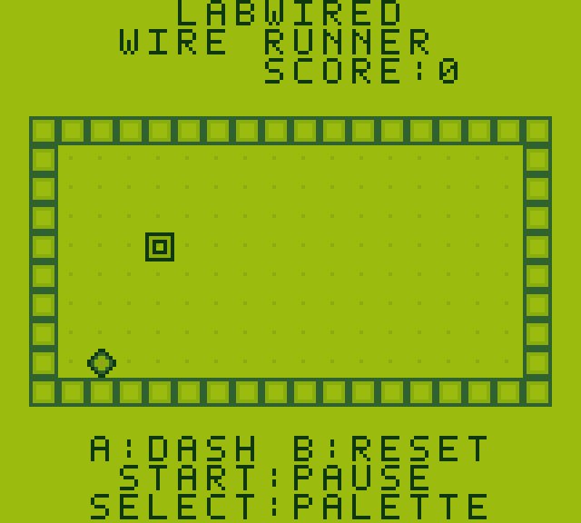

# Game Boy-compatible handheld in LabWired

This example joins an STM32F411 Game Boy emulator, an original playable ROM, a routed carrier PCB, and a revision-pinned KernelCAD enclosure. Peanut-GB executes the ROM's SM83 instructions inside the STM32 firmware. Wire Runner is a 32 KiB original homebrew game. No Nintendo game, boot ROM, logo image, or sound asset is included.

## Open and play

- [LabWired saved project](https://app.labwired.com/?project=f44771855a18a70d418e363622de2e28&run=1)
- [Original firmware checkpoint](https://app.labwired.com/?share=aV3vKsFaQjTi&run=1)
- [KernelCAD assembly, revision 3](https://app.kernelcad.com/p/kQAFdaQs?version=3)

In the LabWired circuit, select **Preview** to operate the on-screen buttons. Let the firmware initialize the display. Hold a direction button to move the chip and collect the diamond. A increases movement speed, B resets the position and score, Start pauses, and Select changes the palette. The project's button `key` attributes are descriptive; global keyboard mappings are not implemented by the generic button component.

The saved project retains the full editable source, exact compiled ELF reference, 10 parts, 24 wires, and KernelCAD revision 3 with its mesh provenance. It includes the verified Right press/release input track. The original firmware checkpoint predates this assembly revision. `project-binding.json` records the fresh saved-project readback and the pending native PCB attachment. The generic CAD view, saved-artifact hydration, display geometry, and saved-project verification changes are tracked in the app integration work. Production rollout status is separate from the hardware design results below.




The first image is CAD geometry. The second is a host-emulated ROM frame; it is not a screenshot of the MCU simulation. Live MCU/browser behavior is recorded separately in `firmware/browser-validation.json`.

## What is connected

| Layer | Authoritative artifact | Connection to the other layers |
|---|---|---|
| Firmware and circuit | `firmware/circuit.json`, `firmware/gameboy.c`, pinned ELF reference | MCU pins drive the SPI display and eight active-low controls. Source and ELF references identify the exact tested binary. |
| Physical carrier | `pcb/handheld-carrier.kicad_pcb` | `pcb/simulation-binding.json` maps simulated parts and pins to physical pad numbers. `pcb/carrier-layout.json` records pad coordinates, nets, and the case transform. |
| Shared packaging | `design-interfaces.json`, `pcb/carrier-layout.json`, `pcb/assembly-interfaces.json` | Shared base dimensions define the outline, mounts and controls. The detailed assembly reads the final pad coordinates and selected connector interfaces; its configuration records revised USB access and stack assumptions. |
| Enclosure | `mechanical/revision-3/labwired-gameboy-assembly.kcad.ts`, `kernelcad-reference.json` | The reference identifies the exact assembly revision, source hash, mesh provenance and PCB hash. The detailed source, generator and validation records are included; generated export binaries are omitted from Git. |

The carrier is 78 × 132 × 1.6 mm. It mounts inside a 90 × 148 × 30 mm shell, with controls increasing overall depth to 32.3 mm. Four 2.8 mm PCB mounting holes use case coordinates x = ±29 mm and y = 16 / 132 mm. Four corner notches clear the case closure posts. The PCB-to-case transform is `case_x = pcb_x - 39` and `case_y = 140 - pcb_y`.

The display is the Waveshare 2.4-inch ILI9341 module with a 70.5 × 43.3 mm PCB and 48.96 × 36.72 mm active area. The carrier uses the WeAct Black Pill v3 physical footprint with forty 1.02 mm holes for the selected Samtec TSW-120-07-G-S headers, an eight-pin JST PH connector for the display cable, eight through-hole switches, and two bypass capacitors. Exact pin assignments and cable order are in `firmware/README.md` and `pcb/simulation-binding.json`.

## Recorded verification

| Check | Result | Evidence |
|---|---|---|
| Hosted firmware compilation | Pass for `stm32f411ceu6-blackpill`, C | `firmware/evidence.json` |
| Firmware model verification | Pass, 50,000,000-step limit; LCD painted; Right input changes the emulated player position | `firmware/control-validation.json` → Right case; the original press-only run remains in `firmware/evidence.json` |
| All eight controls through STM32 GPIO | 8/8 model cases pass; press/release receipts, direction movement, two-pixel A steps, B reset, Start pause/resume and Select palette change | `firmware/control-validation.json`; exact requests in `firmware/control-vectors.json` |
| Original ROM behavior | Pass for all eight controls, score collection, pause, palette, and 17,424 scanlines | `firmware/host-validation.json`; host frame in `firmware/frame.png` |
| Live browser display and input | Pass on local source build: 320 × 240 correctly oriented LCD; Right moves player x = 48 to 63; release observed; 0 page errors | `firmware/browser-validation.json` |
| Current revision 3 viewer and runtime | Desktop and mobile production preview pass the view contract; exact revision loads, the iframe and Worker persist, and the MCU advances by 35,000,000 cycles while CAD is visible; 0 uncaught exceptions | `firmware/browser-revision3-validation.json` and `browser-revision3-assessment.json` |
| Historical revision 2 view continuity | Desktop and mobile passed; the same worker advanced by 60,000,000 and 70,000,000 cycles while CAD was visible | `firmware/browser-view-continuity.json` (earlier local production preview) |
| Final native PCB design-context import | Accepted; 2 mapped, 9 design-only, 5 ignored; automatic runnable twin is unavailable | `pcb/final-import-report.json` |
| Carrier PCB DRC | 0 violations, 0 unconnected items, KiCad 9.0.2 | `pcb/drc-routed.json` and `pcb/routing-report.json` |
| Exact-source preservation and generated-rule DRC | Local pass: original 573,344-byte PCB retained; 0 preparation network calls; KiCad 9.0.2 reports 0 violations and 0 unconnected items with the generated rule bundle | `pcb/native-preserve-preflight/local-preserve-drc-preflight.json` and adjacent raw reports/rules |
| CAD static design loop | Pass for revision 3, 59 parts, 400 features, valid geometry | `mechanical/revision-3/evaluation.json`; `design-loop.json` in the same directory |
| Independent fixed-mate review | 59 parts, 58 solved fixed mates, 1 static pose; 0 actionable interference | `mechanical/revision-3/independent-mates.json` |
| Nominal button and access checks | 8 single-control maximum-pretravel variants, 4 driver corridors and a 30 mm USB withdrawal sweep have no blocking collision diagnostics | `mechanical/revision-3/pose-checks.json`; `collision-regression.json` records the D-pad correction |
| Fastener and assembly-path review | Fasteners: 8 measured, 8 unknown, 0 fully passed, 0 failed. Assembly path: all 59 parts unknown; no sequence established | `mechanical/revision-3/fastener-installation.json`; `assembly-path.json` |
| Mechanical export integrity | All 12 delivered geometry files match byte counts and SHA-256; STEP has 59 valid solids; 10 delivered STL candidates are reported watertight | `mechanical/revision-3/export-verification.json` |
| PCB export integrity | 9 Gerber layers, job metadata, all 124 drill coordinates, and valid bare-board/copper STEP exports match the final PCB | `pcb/export-validation.json` |

The browser display fix propagates the simulator's live width and height into the renderer. It prevents a landscape 320 × 240 ILI9341 buffer from being decoded with a portrait 240 × 320 stride. The app integration includes separate regression tests for display decoding, the simulation host, and the Wasm bridge. Browser evidence is recorded separately as JSON; a painted-display oracle alone does not establish correct browser rendering.

The current revision 3 view check uses application commit `6c183167521892eb9266990558e0f63e2ce05507` in a local production-mode build with authentication disabled. It does not establish deployment or signed-in editing. Each form factor retains nine console/resource errors from the local placeholder sign-in instance and KernelCAD font, telemetry and optional animation requests. The exact static mesh renders and the running MCU survives view switches; the record explicitly has `cleanConsole: false`. Earlier development failures remain recorded: a React development instrumentation memory error and an unlocalized `null.addEventListener` error that did not reproduce in the production preview.

## Scope and material limits

This is a simulated and CAD-checked engineering prototype. No PCB was fabricated, no assembly was fitted, and no physical firmware test was performed. The PCB DRC is not schematic ERC, electrical characterization, or fabrication sign-off.

Power comes from USB through the Black Pill. The detailed enclosure provides a recessed opening for direct access to the module connector. It checks a sourced male-plug overmold and strain-relief envelope along a 30 mm withdrawal sweep. The original extension/pigtail assumption in the revision-2 base interface is superseded by `mechanical/revision-3/assembly-config.json`. Battery and speaker bodies are reserved envelopes only. Battery charging, audio, a cartridge connector, removable ROM storage, and save storage are not implemented.

The firmware uses the 16 MHz HSI clock and 4 MHz SPI. Simulation timing follows the MCU model and does not measure real-time game performance. Regulator margin, LCD backlight current, purchased module tolerances, LCD retention, the complete cable route, soldering access and physical assembly remain unverified. The detailed CAD includes nominal headers, solder-row reservations, eight screw/nut pairs, button support and maximum-pretravel poses. Its fastener audit remains partial where complex blind bores are unsupported. Minimum-height switches can require 0.85 mm stroke, beyond the nominal 0.65 mm stop; plunger lengths must be adjusted from installed switch measurements. The nominal travel checks do not cover that tolerance extreme. The selected header fit in the purchased module is unverified; only the carrier holes have been corrected to the selected header recommendation. C1/C2 bodies, most switch tails and solder, detailed LCD underside geometry and the full harness are not modeled. The enclosure carrier is a mechanical envelope and omits the switch drills, optional SWD drills and vias. Use the native KiCad board and its PCB STEP exports for full drill geometry.

The ROM omits the Nintendo logo header and starts through the emulator's post-boot state. It has not been validated with an original Game Boy boot ROM or a physical cartridge. The included firmware exercises this original ROM; it does not establish compatibility with every commercial game.

The first generic PCB generation returned a 123 × 88 mm placeholder board with an incorrect MCU footprint. That board is detached from the saved project. The accurate KiCad carrier is included here. Normal owner access was observed on 2026-11-10; native attachment is pending deployment of source-preserving admission and the project-board ownership/revision guard, then hosted independent DRC and attachment readback. The local preservation preflight checks the exact authored PCB and generated rules without a hosted job or project mutation. Its pass does not establish a hosted board identity or live production integration.

The existing KiCad import accepts it as design context but cannot automatically derive the runnable twin from the WeAct module and switch footprints. The explicit simulation binding therefore remains the electrical handoff. No automatic round-trip or exact assembled fit is claimed.

## Files and reproduction

`manifest.json` indexes the source, design interfaces, immutable identities and evidence. `firmware/` contains the original ROM, generators, Peanut-GB header, STM32 integration, amalgamated hosted source, circuit, immutable compiled-artifact reference and test evidence. `pcb/` contains the editable KiCad board, DRC, assembly proposal and routing generators. `mechanical/revision-3/` contains the current editable CAD, generator and validation records. The revision 2 source and evidence remain in `mechanical/` as a historical packaging concept; `mechanical/kernelcad-reference-v2.json` retains its exact pin. Revision 2 evidence does not validate the corrected PCB or the detailed assembly. Generated ELF, Gerber, drill, STEP, GLB and STL files are omitted from this compact repository contribution. Use the sources to rebuild firmware and regenerate exports; recorded hashes identify the artifacts from the measured runs. The current mechanical export record classifies the printable parts, purchased hardware, component envelopes and cable reservations. Only its ten candidate print parts are intended for slicing; exact source identities and declared limitations remain part of the handoff.

From `firmware/`, run:

```sh
python3 build_rom.py
python3 build_firmware.py
cc -std=c99 -O2 host_verify.c -o /tmp/wire-runner-host-verify
/tmp/wire-runner-host-verify /tmp/wire-runner-frame.ppm
```

### Hosted MCU rebuild and verification

The amalgamated C source is **121,279 bytes**, above the 64 KiB inline compile limit. The verified rebuild path uses the existing MCP source-reference workflow:

1. Call `labwired_put_source` with the contents of `firmware/gameboy.c` as `source` and `entryPath: "src/main.c"`. Keep its returned `source_tree_ref` and per-file refs.
2. Call `labwired_compile` with that `source_tree_ref`, `board: "stm32f411ceu6-blackpill"`, `language: "c"`, and `entryPath: "src/main.c"`. Do not send the large entry inline to compile.
3. Load `firmware/circuit.json`. Call `labwired_verify` with that diagram plus the arguments in `firmware/verification.json`. For an edited rebuild, use the newly returned `firmware_ref` and update the diagram's artifact and source references to the same build.
4. Require `status: "model_verified"`, every oracle clause passing, and the Right press and release reported as applied at cycles 22,000,000 and 35,000,000. The run limit is 50,000,000 MCU steps.

This does not depend on a browser inline rebuild of the large C file. The host check above tests the cartridge through Peanut-GB; the hosted check tests the compiled STM32 firmware and modeled peripherals. Reproduction steps for the board and enclosure are in their READMEs. Run KiCad DRC again after each board regeneration.

## License and provenance

Original example code, Wire Runner, and authored design generators use the MIT license in `LICENSE`. Peanut-GB and its included SameBoy portions retain their original MIT notices. WeAct's vendor files retain their own provenance and upstream copying permission. KiCad library footprints retain their library terms and design exception. See `THIRD_PARTY_NOTICES.md` and `source-provenance.json` for precise source identities and hashes.

Primary references: [Peanut-GB](https://github.com/deltabeard/Peanut-GB), [WeAct Black Pill KiCad files](https://github.com/WeActStudio/WeActStudio.MiniSTM32F4x1/tree/master/Hardware/KiCAD), [Waveshare LCD module](https://www.waveshare.com/wiki/2.4inch_LCD_Module), and [KiCad library license](https://www.kicad.org/libraries/license/).
