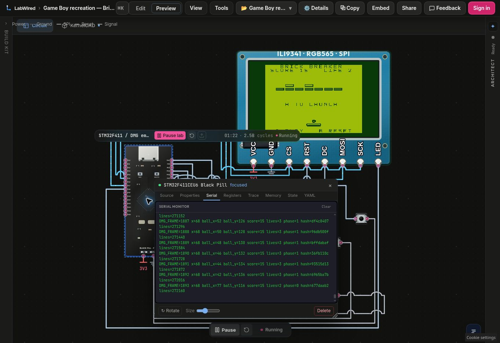

# Simulation speed: promoted firmware

**The firmware candidate completes 39 DMG frames in the same 50,000,000-step
hosted STM32 run where the saved baseline completes 16.** The six-clause oracle
and four input events are unchanged. This is a 2.44× bounded instruction-budget
result, including boot. It is not a browser wall-clock frame-rate measurement.
The optimized firmware was installed in the original saved project on
2026-11-11 at 22:08:40 UTC and passed the same saved-project oracle. Readback
completed at 22:09:01 UTC. The original recording ROM remains unchanged.

A separate [browser observation](browser-circuit-comparison.json) measured
approximately 5.5 game frames/s for the baseline and 18.6 for the optimized
firmware in the same Circuit-view tab. Each result is one short sequential
window, with different game segments and observation uncertainty. These are
firmware game-frame counts, not raster display FPS. WebGL2 was unavailable in
that browser, so this comparison does not measure the CAD view.

## Cause and changes

The cartridge polls the DMG LY register until VBlank. Peanut-GB therefore
executes thousands of waiting instructions inside the already simulated STM32.
The candidate uses the DMG VBlank interrupt and `HALT` to wait for the same next
frame. Its main game logic still executes in the cartridge.

The MCU already skips unchanged scanlines, but a changed scanline sends all
240 scaled pixels. The candidate caches native shade pixels and writes only the
changed horizontal span through the same STM32 SPI and ILI9341 window commands.
This includes old sprite positions, so movement erases the previous pixels.
It preserves the exact integer 160×144 → 240×216 mapping and RGB565 palette.

The hosted scaffold uses GCC `-Os`. The candidate requests GCC `O3` for this
CPU-heavy translation unit. It uses ordinary integer optimization, without
fast-math, different simulated clocks, host-side game execution or frame skips.

| Variant | Completed DMG frames at 50M steps |
|---|---:|
| Saved baseline | 16 |
| VBlank / HALT | 25 |
| VBlank / HALT + dirty spans | 29 |
| VBlank / HALT + dirty spans + O3 | 39 |

## Evidence

[performance-comparison.json](performance-comparison.json) names exact hashes,
requests and results. [candidate-verification.json](candidate-verification.json)
records all six oracle clauses passing and all four input events applied.
The baseline run and both exact request objects are retained beside it.

[promotion-receipt.json](promotion-receipt.json) records the guarded save,
unchanged six-clause `labwired_project_verify` call with `max_steps: 50000000`,
and readback. The content and verified hashes both equal
`2d1cfec8ca700fadfb944b1a4ab3e213437ab021e61ca21f6b1097bd2d4781a2`.
The exact four-field [update request](promotion-update-request.json) includes
all 126,041 bytes of optimized C and the complete original diagram with only
its firmware artifact/source references changed. The name, unlisted visibility,
PCB revision, input events, CAD revision and nine bindings are unchanged.

The [rollback receipt](promotion-baseline-rollback.json) retains the full old
source and diagram. Its expected-hash placeholder must be replaced by a fresh
`labwired_project_get` hash before any deliberate rollback. No rollback was
performed. A restored source needs its own fresh declared-oracle verification.

The same input script produces identical per-frame LCD hashes and all 13 game
state bytes across 2,400 frames for the old and new ROM. Both traces have SHA-256
`b0f207665b1be8c3fdd9d7cd2dd6b66a0b975c764cb64be51b67d04d2111514f`.
Both complete the controls/collision checks with score 47, 25 paddle bounces and
three lives. ROM reads during the same 2,400-frame sequence fall from 31,807,096
to 619,132.

The pixel fixture executes both actual C LCD draw functions on the same frames.
Every RGB565 framebuffer and full-frame hash matches. It also checks one-pixel
changes and erasures across all 160 source columns. Pixel bytes fall from
19,663,200 to 1,468,626 (92.53% fewer); both paths issue 27,315 windows. These
counts are from the deterministic fixture, not inferred from an overflowed
logic-analyzer trace.

The candidate ELF has 56,820 bytes of code/read-only data, 104 bytes of `.data`,
40,156 bytes of `.bss` and 1,540 bytes of reserved heap/stack plus alignment.
The linker sets `_estack` to `0x20020000`. Static RAM plus that reservation is
41,800 of 131,072 bytes; 89,272 bytes remain outside those allocations. This is
linker accounting, not a measured worst-case stack watermark.

The baseline ELF is
`sha256:cfa5fd07dbaa457d7e3315d69d5076c90b70f453d490229889e440a595ea4681`.
The candidate ELF is
`sha256:e7f8031ab996136da9202409bc7ec3fef12510d262c2da7266a20247ca299f28`.
The candidate source tree is
`sha256:5cbc1cb8e76bb37a3ae892b6891a76d1dbd7a95f7da01f1ad93d03093bb9979e`.

## Saved-project browser readback

After promotion, the original saved project was reopened in the browser. An
actual A press/release launched the game, the score reached 15, and the LCD and
UART continued updating. The [browser observation](saved-project-browser.json)
records the input action separately from the still image. The image shows a
missed ball: UART lives change from 3 to 2 and the LCD returns to A TO LAUNCH.
This is Circuit-view evidence; WebGL2 was unavailable in that cloud browser.



## Reproduce in isolated checkouts

The patch targets the example at repository commit
`e5606fb14eb88292d2064810cf4075c67e5e55c8`. Keep one checkout as the baseline.
Apply [candidate-source.patch](candidate-source.patch) to a separate checkout,
then run its existing `firmware/build_brick_breaker.py` and
`firmware/build_brick_breaker_firmware.py`. The resulting source and ROM hashes
must match the candidate receipt. The original saved-project sources and movie
inputs do not need to be changed for this comparison.

Compile `host_equivalence.c` with each checkout's firmware directory as its
include path. Run each binary and compare its standard-output trace. Diagnostics
on standard error report the ROM-read count and gameplay checks. The trace
hash above binds the tested per-frame states.

Generate the LCD fixture from the two actual MCU source files:

```sh
python3 make_display_test.py \
  --baseline-main <baseline>/firmware/brick_breaker_main.c \
  --candidate-main <candidate>/firmware/brick_breaker_main.c \
  --rom-dir <candidate>/firmware \
  --output /tmp/display_test.c
cc -std=c99 -O2 /tmp/display_test.c -o /tmp/display-test
/tmp/display-test
```

For hosted reproduction, use the existing generic `labwired_put_source`,
`labwired_compile` and `labwired_verify` calls in the adjacent JSON receipts.
Do not shorten or remove oracle clauses. The recorded Circuit observation is
separate from the deterministic hosted instruction-budget comparison. The CAD
display-bridge throttle still needs its own browser measurement; this firmware
promotion does not deploy the separate application patch.

## Scope

The candidate still runs the ROM inside Peanut-GB on the modeled STM32F411.
GPIO inputs, all eight CAD controls, the LCD binding, real SPI writes, CAD
geometry, native PCB reference and unlisted visibility are preserved.
The hosted model retains its documented CPU-derived timing and ideal-supply
approximations. No physical-hardware timing is measured.
