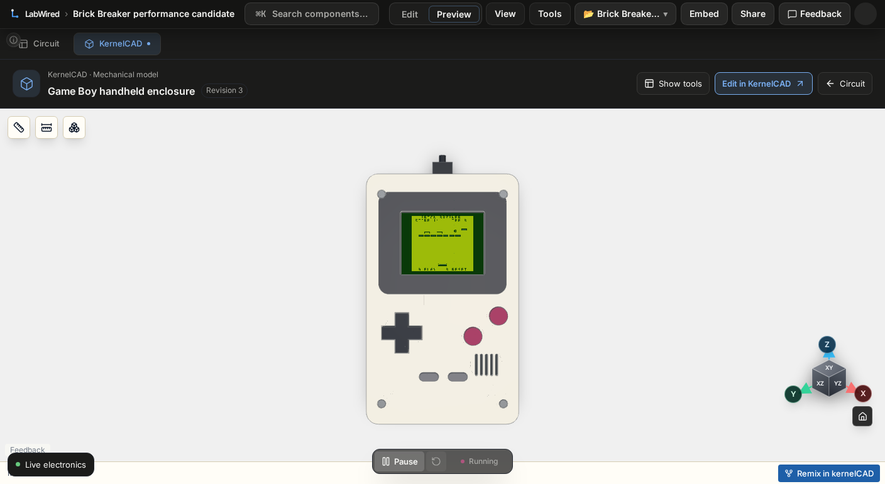

# Worker snapshot browser evidence — 2026-11-11

The baseline observation completed. The after condition failed during Preview input preparation, so this evidence does **not** verify a performance improvement or regression.

## Measured baseline

A fresh Playwright 1.58.0 Chromium 145.0.7632.6 headless context ran the existing Vite preview at UI base 6093f09869e99c28e079dee5c4a1d018434b9966. The viewport was 1408×771. The sequence was Circuit Preview, a native A hold/release, normal Pause, KernelCAD readiness/front view, normal Run, a 1 s warmup, and a requested 5 s sampling wait. All observed game phases in the measurement remained 1.

| Observation | Recorded result |
|---|---:|
| Parent sampling interval |7.072 s|
| Child sampling interval |7.6522 s|
| UART snapshot observation interval |8.6756 s|
| Game frame counter |258 → 294|
| Game frames per UART observation second |4.1496|
| CAD display-bearing messages |4 → 7; 0.3920 messages/s|
| Fully contained worker requests |5|
| Worker request duration median |1361 ms|
| Worker request duration maximum |1606 ms|

The before UART snapshot was 1.6039 s old; the after snapshot was 0.0003 s old. Dividing 36 game frames by the outer parent interval would bias the result. Each rate above uses its own context/observation clock. Six replies arrived in the parent window; one request began before the window, so only five requests are fully contained. p95 is omitted for this small sample; exact durations are in summary.json and baseline.json.

CAD counts are messages carrying display data. They are not measured render/presentation FPS. This is one instrumented development/headless observation, not a production-rate guarantee.

The native A press is supported by INPUT=000000fe and a setBoardIoInput(true) command. A release command is recorded, and all eight input values are zero in both measured CAD frames. The firmware release UART marker was not retained in the bounded tail. The optional final Pause click timed out **after** measurement records and the screenshot were saved. That cleanup warning is preserved separately; the browser was closed.

## Failed after condition

The disposable preview changed only four production files: SimHost.ts and workerEngine.ts from worker PR #3126, and kernelcadRuntime.ts and useKernelCadElectronics.ts from bridge PR #3124. The bridge owner independently verified both copied files against the exact remote commit. No engine, firmware, origin policy, or simulation-state workaround was added.

The final attempt found the Preview button visible, enabled, and stable. Scrolling completed, and Playwright logged performing click action. It then timed out after 15 s, before A input and before a measurement. There is no retained pointer-event or click-completion acknowledgement. The trace cannot distinguish incomplete dispatch from delivery followed by an unresponsive renderer. No page-crash event was retained. The browser was closed; no further attempts were made.

Actual WASM response bytes match the baseline hash. The after firmware initialization record was not retained before the failure. There is no after sample or after-input CAD screenshot. This evidence therefore cannot support a causal performance conclusion.

## Source and runtime identity

- UI base: 6093f09869e99c28e079dee5c4a1d018434b9966.
- Worker PR #3126 commit: a426ab0651f984527907ef9c4bd7543347833ceb.
- Bridge PR #3124 commit: bcb81d250ffb254026e5cafed6d4350822e15f86.
- Baseline firmware SHA256: e7f8031ab996136da9202409bc7ec3fef12510d262c2da7266a20247ca299f28; 210,992 bytes.
- Actual WASM SHA256: 0ccceb8db3fe4a3a4e1f25cdfecbfb9a568c81f2ef0f2bc15a6a20198e092421; 12,400,007 bytes.
- Actual package glue SHA256: d7459741ce016448364d0272b430df90c024258bd88d7f989078760ed076b862.
- Downloaded public glue SHA256: 9de2fcae6152917c85c09f46517b26964235769de6b7e81c87155ac7a2ff8bd4. Five generated shim-index comments differ; executable lines match.

Full before/after source hashes, runtime response receipts, observed initialization metadata, input commands, raw selected worker durations, and sample clocks are included. The retained harnesses use the original Work-1 paths and existing preview/browser installation. They contain read-only instrumentation and normal UI input. No WASM or ELF binary is included.

The after harness skips a click when Circuit is already selected and omits the optional final Pause. These differences are outside the measured sequence. The original observer logic, game input, pause/load/resume sequence, warmup, requested interval, viewport and camera action are otherwise identical.

## Files

- summary.json: conclusion, exact clocks, counts, limitations and hashes.
- baseline.json: recorded samples, six in-window replies, input/config and paused CAD proof.
- baseline-cleanup-warning.json: post-sample Pause timeout.
- failed-after.json: complete bounded failure trace.
- source-receipts.json and runtime-receipts.json: provenance.
- baseline.png: actual browser screenshot after the baseline sample.
- harness-before.mjs and harness-after.mjs: exact test programs.
- manifest.json: SHA256 of every bundled file.
