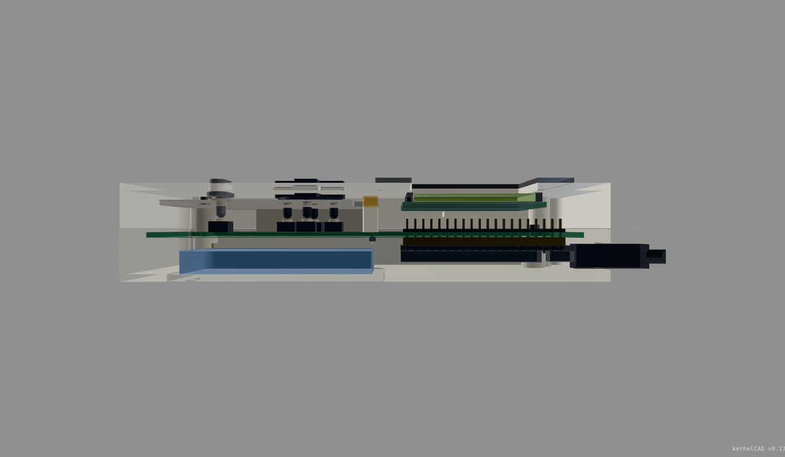

# Game Boy handheld assembly detail — revision 3

This revision adds a nominal mechanical assembly around the routed carrier. It keeps the 90 × 148 × 30 mm shell and adds seated Black Pill headers, solder allowances, guided button plungers, a support plate, captive nuts, screw access, direct USB access, and the relocated display connector. It is an evaluated packaging study. It is not a completed physical fit or manufacturing release.

[Open the saved KernelCAD revision](https://app.kernelcad.com/p/kQAFdaQs?version=3). `kernelcad-reference.json` contains the exact source hash, immutable mesh provenance, native PCB hash and embed URL. Revision 2 remains in the parent mechanical directory as historical evidence.


## Source and physical interfaces

`labwired-gameboy-assembly.kcad.ts` is generated by `build_assembly.py` from the historical `../../design-interfaces.json`, the final native PCB export `../../pcb/carrier-layout.json`, sourced component dimensions in `../../pcb/assembly-interfaces.json`, and this directory's `assembly-config.json` and `assembly-body.ts`.

The source is bound to native PCB SHA-256 `e7224485efa449271fa0512791f898469b48650111884b55052957224e9cb9df`. The generator reads actual A1 and J1 pad positions and drills. Switch centers come from the mean of each exported switch's pads, because its footprint origin is a pad, not its body center. The PCB-to-case transform is derived from the shared carrier dimensions. It does not copy a second set of component coordinates into CAD.

`derived-interfaces.json` records the input hashes, exported outline, exact transformed pins, switch centers and effective interfaces. Revision 3 explicitly overrides the historical USB extension aperture and speaker reservation through `assembly-config.json`; those effective values are recorded without modifying revision 2's inputs. The carrier solid uses the shared rounded profile and case-post notches. The native KiCad outline is also retained in the handoff. The carrier CAD remains an envelope and omits 32 switch drill holes, four optional SWD holes and vias; the native PCB and its STEP export contain that drill geometry.

Regenerate the source and nominal ledger from this directory:

```sh
python3 build_assembly.py
python3 check_dimensions.py
python3 build_check_cases.py /tmp/gameboy-cad-checks
```

The last command reconstructs the exact ten evaluated variants and checks their SHA-256 hashes against `pose-checks.json`. A changed source requires new evaluation evidence. The hosted evaluation used OCCT 0.17.4 and engine revision `40c8a380064e46cfa8aad3bbe145ed7fb3c1f06c`. Its dependency ledger reports `untracked`; the engine identity and downloaded exports are preserved, but the tool does not claim complete dependency tracking for catalog parts.

## What changed

| Interface | Revision 3 construction |
| --- | --- |
| Black Pill headers | Two Samtec TSW-120-07-G-S nominal envelopes. Their 2.54 mm collars seat against both board faces. All 40 full-length square pins are represented. |
| Header solder | Conservative row envelopes represent the carrier-side solder allowance. They are not reconstructed solder fillets. |
| Display connector | JST B8B-PH-K-S and PHR-8 combined nominal envelope, with all eight straight terminal envelopes and a rear solder allowance. Placement comes from J1's final PCB pads. |
| Display cable access | J1 moved below the LCD. A 22 mm-wide notch opens through the support-plate edge; a separate 3 mm-high volume reserves space above the mating housing for wire exit. |
| Buttons | Nominal Omron B3F-1000 bodies and actuators, spherical-ended plungers, guides, ordinary-button stops and a spherical D-pad pivot. |
| D-pad aperture | 0.6 mm clearance per side. The earlier 0.4 mm aperture produced a blocking collision in the maximum up pose. |
| Fasteners | Eight M2.5 captive nuts; six ISO 4762 M2.5 × 20 screws and two M2.5 × 8 screws. Catalog screw envelopes preserve the fastener audit interfaces. |
| Tool access | Two 5.8 mm bezel scallops clear the upper screw axes. All four case-screw locations were checked with a straight 4 mm shaft reservation. |
| USB | A 13.2 × 8.2 mm direct-access aperture replaces the unspecified internal extension. The inspected external plug overmold can enter the rear shell in the nominal model. |

The inspected SparkFun cable drawing gives a 22 mm-long male overmold and a 32 mm-deep female panel body. These do not support the earlier short, straight internal-extension assumption. The revised model uses only the male-end dimensions as an external plug reference. It does not establish fully seated connector engagement or route an internal cable.



## Recorded results and their scope

The final rest source contains **59 named parts and 400 features**. Full evaluation passes with no diagnostics. The independent static review reports **59 bodies, 58 fixed mates and zero actionable interference**. Its 116 informational notices mean point-based connectors do not compare hole diameters through feature records. They are not physical fit certificates.

`pose-checks.json` records eight separate single-control poses at the maximum specified 0.45 mm switch pretravel, with nominal 4.3 mm switch height and zero plunger adjustment. Each includes the 0.2 mm initial gap. All eight pass full evaluation with no blocking collision diagnostics. These are static geometry variants; they are not a continuous articulated mechanism, a switch-force model or a simultaneous diagonal-input test.

The same record contains the four case-screw shaft corridors and an exact 30 mm positive-Y swept envelope of the modeled USB overmold and axial strain relief. Both pass with no blocking collision diagnostics. The USB sweep excludes the metal plug's engagement geometry and assumes the declared mouth and shoulder datums. It establishes clearance of that nominal outer envelope through the case, not connector mating fit.

`collision-regression.json` preserves the collision positive control and correction. The initial maximum up pose failed on a front-shell/D-pad overlap of 0.21 mm³, 0.020 mm thick. The final source and all passing variants have explicit hashes. The evaluator did not return a per-variant `interferenceSummary`; the recorded conclusion is no blocking collision diagnostics, supported by the active solved-model collision check.

| Nominal result | Value | Basis |
| --- | ---: | --- |
| Full header pin protrusion above carrier | 4.24 mm | Untrimmed 5.84 mm post minus 1.6 mm carrier thickness |
| Header pin tip to LCD underside | 3.36 mm | Declared stack and checked body bounds |
| Black Pill component envelope to rear floor | 3.46 mm | Declared 3.4 mm component allowance |
| J1 housing to LCD, along Y | 7.65 mm | Final native PCB placement and LCD outline |
| J1 terminal tip to battery reservation | 2.30 mm | Nominal 3.4 mm tails and reserved battery volume |
| USB opening clearance around overmold | 0.40 mm per side in X and Z | Inspected overmold and designed aperture |
| Nominal button cap stroke | 0.45 mm | 0.20 mm gap + 0.25 mm nominal pretravel |
| Maximum nominal-height cap stroke | 0.65 mm | 0.20 mm gap + 0.45 mm maximum pretravel |
| Modeled nut engagement, all eight stations | 2.00 mm | BREP axial-overlap audit |
| Head bearing gaps | 0–0.01 mm | BREP fastener audit |

The full fastener-installation result remains **partial: eight measured, eight unknown, zero fully passed stations**. All eight engagement and bearing metrics pass. The audit cannot resolve the complex/captive or blind shell bores and several carrier bores. `fastener-installation.json` retains these unknowns. Threads are clearance envelopes; engagement is axial overlap, not thread contact, torque, preload or boss strength.

The bounded assembly-path run returned **unknown for all 59 parts** after its work budget was exhausted and produced no sequence steps. `assembly-path.json` preserves this result. The model does not establish a complete assembly sequence. Separate driver and USB geometric checks do not replace that missing sequence proof.

`clearance-ledger.json` records nominal calculations and assumptions. `cross-layer-review.json` records a separate read-only comparison against the frozen PCB inputs. `design-loop.json` records the green static design loop and actual CAD screenshot review. The modeled aggregate volume is 162,188.689 mm³ and includes hardware and clearance envelopes; it is not a plastic-use estimate.

## Generic live electronics configuration

`electronics-bindings.json` is the exact version-1 value saved at `diagram.mechanical.electronics`. It maps `lcd1` to the existing `lcd1-active-glass` face and all eight circuit control IDs to the existing button/D-pad parts. It does not edit the evaluated CAD source or create another simulation. `electronics-bindings-provenance.json` records the exact CAD/source identities and coordinate checks. The saved configuration and fresh declared-oracle firmware verification are recorded in `../../firmware/final-project-binding-readback.json` and `../../firmware/saved-project-verification-final.json`. The later metadata save preserves the evaluated CAD revision and all firmware/circuit source identities.

The bindings use the positive-Z face, with local face coordinates `u = x`, `v = y`. Four disjoint normalized arm regions select directions on the shared `dpad` mesh; the center pivot is excluded. The receiver must aggregate simultaneous pressed states for that shared part. The 0.45 mm displacement represents the nominal 0.20 mm gap plus 0.25 mm switch pretravel. It is a visual runtime displacement, not a continuous tilt or force model.

The display binding uses rotation 0 because the MCU snapshot is already 320 × 240 landscape. The circuit component's rotation 90 setting describes its 2D pose and does not rotate runtime pixels. The generic viewer's exploded view is an inspection aid; the bounded mechanical assembly-path check above still returned no validated sequence.

## Export and fabrication classes

`parts.json` classifies all 59 bodies. **Only ten are fabrication candidates:** front shell, rear shell, service cover, bezel, button support, D-pad, A, B, Start and Select. The other 49 are purchased-hardware envelopes, component references or clearance reservations. Do not print the full assembly or the purchased-part envelopes.

The compact Git contribution keeps source, evidence and two actual CAD images. The separate delivery exports contain the full STEP/GLB assembly and the ten candidate STL parts. `export-verification.json` records the downloaded bytes, hashes and geometry checks. STEP and STL geometry uses millimetres; STL parts retain their assembled coordinates and have not been sliced or oriented for a particular printer. No printability, material-strength or tolerance certification is implied.

## Remaining physical dimensions and assembly gaps

- **Purchased Black Pill fit:** the selected outline is V3.0. Board thickness, maximum component height, pin-to-outline offset and USB mating datum remain conditional. The model's 1.02 mm module holes are an explicit clearance assumption. Comparative V3.1 STEP holes are 0.9 mm; this does not establish interchangeability or worst-case fit with the selected 0.635 mm square pins. The carrier's 1.02 mm holes are a separate sourced design choice.
- **USB seating:** the model assumes the mouth at the board's upper edge, a 1.6 mm center height below the module component face, and the overmold shoulder 0.5 mm beyond the mouth. The inspected 12.4 × 7.4 mm overmold section is real. Those seated datums and the actual purchased connector must be measured.
- **Button tolerances:** at minimum switch height, the maximum required stroke can be 0.85 mm, exceeding the nominal 0.65 mm ordinary-button stop. Plunger length needs measured adjustment. The editable `plungerAdjustmentMm` choices are design adjustments, not a validated tolerance range. Pretravel is not an allowable overtravel specification. Forces, diagonal presses, wear and cycle life are unverified.
- **Harness:** the PCB assembly notes require re-termination into a PHR-8 reference housing and verification of the exact endpoint pin order. The supplied cable's housing, crimps, bends and strain relief have not been measured. The 3 mm wire-exit reservation is not a bend-radius specification or a complete route.
- **Other components:** C1/C2 bodies and leads, most switch tails and solder, other small components, and the LCD connector/underside details are not modeled. The static no-interference result applies only to the represented bodies.
- **Retention and power:** LCD retention, service-cover retention, final speaker selection, battery selection and a battery power/protection/charging circuit remain unfinished. The battery and speaker bodies are reserved volumes.

The next physical step is to measure the selected module/header and cable interfaces, set plunger lengths from installed switch heights, complete retention and harness routing, then evaluate the revised source before making fit samples.

## Primary dimension sources

- [WeAct MiniSTM32F4x1 hardware](https://github.com/WeActStudio/WeActStudio.MiniSTM32F4x1/tree/master/Hardware) and [V3.0 outline image](https://raw.githubusercontent.com/WeActStudio/WeActStudio.MiniSTM32F4x1/master/images/STM32F4x1_V30_BoardShape.png). V3.1 CAD is comparative evidence only.
- [Samtec TSW-120-07-G-S](https://www.samtec.com/products/tsw-120-07-g-s), [drawing](https://suddendocs.samtec.com/prints/tsw-xxx-xx-xxx-x-xx-xxx-mkt.pdf) and [recommended footprint](https://suddendocs.samtec.com/prints/tsw-xxx-xx-x-x-xx-xxx-footprint.pdf).
- [Omron B3F datasheet](https://omronfs.omron.com/en_US/ecb/products/pdf/en-b3f.pdf), B3F-1000 dimensions and pretravel.
- [JST PH catalog](https://www.jst-mfg.com/product/pdf/eng/ePH.pdf) and [manufacturer terminal drawing mirrored by Pololu](https://www.pololu.com/file/0J373/JST_ePH.pdf). The straight terminal envelope omits the retention kink.
- [SparkFun ACCA-2517 cable drawing](https://cdn.sparkfun.com/assets/8/0/8/7/4/ACCA-2517_Model.pdf).
- [Waveshare 2.4-inch LCD module](https://www.waveshare.com/wiki/2.4inch_LCD_Module), XY outline and active area.
- [M2.5 × 20 socket screw dimensions](https://www.accu.co.uk/metric-cap-head-screws/3057-SSC-M2-5-20-A4) and [M2.5 hex-nut dimensions](https://www.accu.co.uk/hexagon-nuts/642965-HPN-M2-5-5-BR). Screw geometry comes from KernelCAD's bundled ISO 4762 catalog.
