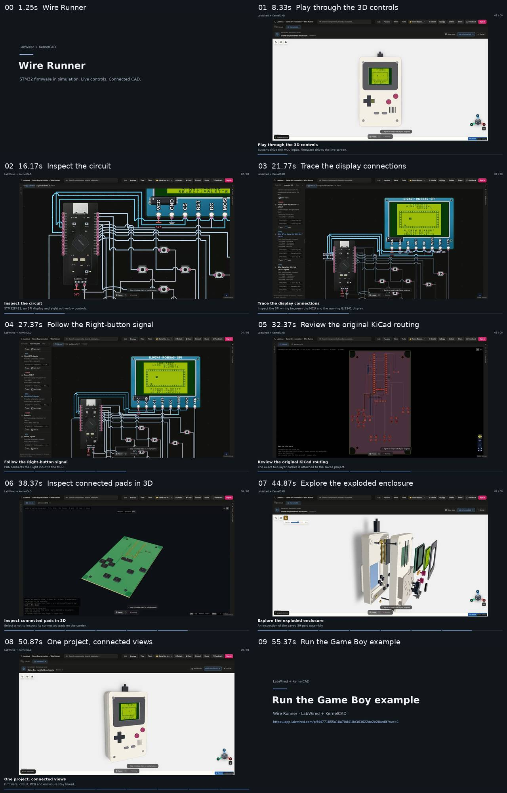

# Wire Runner recorded demonstration

## Current 18-second Brick Breaker cut

The current demonstration uses independently rendered CAD poses, the routed native carrier, a controller close view, and actual original-ROM gameplay. Portable source and reproduction instructions are in [promo-v3/README.md](promo-v3/README.md). The final 18-second, 60 fps MP4 is delivered separately; its metadata and provenance are retained with the rebuild sources.

The remaining material below records the earlier Wire Runner app capture.

[Watch the 57-second MP4](gameboy-wire-runner-promo.mp4).

The video is **57.367 seconds**, **1920 × 1080**, **30 fps**, H.264/YUV420P, with silent captions and fast-start MP4 metadata. Its SHA-256 is `052b5fdbe0e2f68165461f3dec552bd7dc1776df714c393d82fdadf3ecad92d1`; its size is **4,770,240 bytes**.

## What was recorded

The footage comes from actual LabWired and KernelCAD execution. The browser used production builds through GET response proxies under the normal public app origins. These recordings are build-level browser proof; they do not independently certify the final public asset deployment. The project and firmware are the saved example, with its existing simulator and revision-3 CAD binding. No separate game simulation or synthetic hardware animation was added.

The final manual Right press and release produced exactly two runtime input events, values 1 then 0. The MCU UART reported `INPUT=000000ef` then `INPUT=000000ff`; the original ROM player moved from x = 48 to x = 87. The 320 × 240 LCD buffer hashes changed from `ac01d08a` to `8bdf87f2` to `94eea4d2`. All nine display/input bindings were accepted with no missing CAD parts. `runtime-control-proof.json` summarizes those observations; `runtime-control-observation.json` retains the underlying UART, cycle, framebuffer and bridge evidence, with session nonces omitted.

The circuit clips show the real wiring inspection. The native 2D PCB clip shows the exact authored KiCad routing. Selecting a PCB net highlights connected pads; it is not a current animation. The exploded enclosure is an inspection of the 59-part saved assembly, not a validated assembly sequence. Physical hardware has not been fabricated or tested.

The intermediate coordinate-click miss and the old development, loading, visible-error and bad-orbit intervals are excluded. The final control, angled exploded view and closing hero use the later validated recording. Nonfatal console diagnostics are retained in the control proof, so no clean-console claim is made.

## Editing and checks

`promo-clips.json` records every source interval and caption. The edit uses hard cuts, the complete recorded app frame, a 2.5-second intro and a 4-second canonical project CTA. Captions sit outside the footage. Playback speed is unchanged; the 25 fps source frames are sampled/repeated into the 30 fps output. No source audio, external media or replacement framebuffer is added.

`promo-edit.json` records source hashes, measured timings, encoding parameters and commands. `promo-ffprobe.json` records the output streams and chapters. The complete video decoded without errors. All ten rendered chapters and the selected control/exploded/hero source frames were visually reviewed; `promo-visual-qa.json` records that review. The final MP4 was then fixed for transfer without further encoding.



## Files and reproduction

The final MP4 is included. The two long raw browser captures are omitted from this compact contribution; their byte counts, hashes, format and source durations remain in the provenance. Supply matching captures as `raw/circuit-and-pcb.webm` and `raw/controls-and-enclosure.webm` to reproduce the edit with Python 3.10+, Pillow and FFmpeg with libx264/drawtext:

```sh
python3 edit-promo.py raw/circuit-and-pcb.webm promo-clips.json rebuilt.mp4 --crf 19 --threads 4
```

The source filenames and temporary render paths in the public edit record are normalized for portability. The recorded output hash identifies the delivered artifact; different FFmpeg/x264 versions can produce different encoded bytes.
