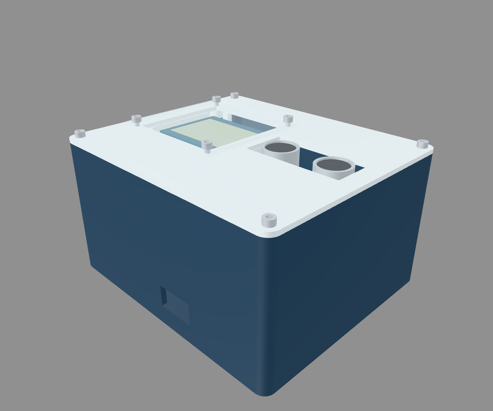

# Nokia 5110 Breakout device

This package uses the existing Nokia Lab's **NUCLEO-L476RG** and PCD8544 display interface. The physical display is **Joy-IT SBC-LCD84x48 REVISION 2**. The distance input is **Adafruit 3942 HC-SR04**, powered at 5 V. The routed carrier provides a 10 kΩ / 18 kΩ ECHO divider for PB10, separate 3.3 V LCD power, local decoupling, and five test points.

Canonical Lab: [Nokia 5110 Breakout](https://app.labwired.com/?lab=nokia5110-invaders-lab). The internal invaders identifier is retained; the firmware implements Breakout.

## Package status and entry points

This is a complete **engineering candidate**: routed native PCB, the exact firmware source and programming files, a purchase BOM, an editable enclosure, print/cutting files and an assembly procedure. Physical prototype qualification remains open. The full assembly-path attempt was inconclusive after the hosted 300-second evaluation limit; the complete receipt is retained in the release manifest.



| Task | Entry point |
| --- | --- |
| Open the existing Lab | [Nokia Breakout](https://app.labwired.com/?lab=nokia5110-invaders-lab) |
| Edit the routed PCB and schematic | [KiCad project](electronics/nokia-carrier.kicad_pro) |
| Buy all parts | [Complete BOM](bom.csv), with [carrier placement BOM](electronics-bom.csv) |
| Build or program firmware | [Firmware instructions](firmware/README.md), [ELF](firmware/artifacts/nokia-breakout.elf), [BIN](firmware/artifacts/nokia-breakout.bin) |
| Edit the enclosure | [Portable source](mechanical/nokia-breakout-enclosure.kcad.ts), [saved Studio revision 1](https://app.kernelcad.com/p/YhZimWlS?version=1) |
| Import the complete geometry | [85-solid assembly STEP](mechanical/nokia-breakout-assembly.step) |
| Print the case | [Base](mechanical/nokia-base.stl), [lid](mechanical/nokia-lid.stl), [LCD clamp](mechanical/nokia-lcd-clamp.stl) ×2, [sonar clamp](mechanical/nokia-sensor-clamp.stl) ×2 |
| Cut the clear window | [DXF](mechanical/nokia-window.dxf), [dimensioned drawing](mechanical/nokia-window-drawing.svg) |
| Assemble and qualify | [Assembly and bring-up](ASSEMBLY.md), [mechanical interfaces](mechanical-interface.json), [electrical interfaces](hardware-interface.json) |

### Verified results

| Check | Result | Evidence |
| --- | --- | --- |
| Local native ERC/DRC | Zero violations, zero unconnected items, zero parity differences | [ERC](validation/erc.json), [DRC](validation/drc.json) |
| Independent hosted native import | KiCad 10.0.8 DRC passed with zero errors, warnings or exclusions | [Native import](validation/native-import-validation.json) |
| Exact standalone firmware | All seven existing behavioral oracles pass; the released ELF is the tested ELF | [Behavior receipt](validation/firmware-behavior.json), [full log](validation/firmware-behavior.log) |
| Packaged clean-run baseline | 5 million steps, one stop-reason assertion; built-in descriptor resolves correctly | [Smoke receipt](validation/firmware-smoke.json) |
| Enclosure review | Seven fit requirements and seven recorded visual checks pass | [Design loop](validation/design-loop.json), [visual review](validation/visual-review.json) |
| Native assembly export | 85 of 85 BREP solids are valid after STEP re-import | [STEP inspection](validation/assembly-step-inspection.json) |
| Print and cutting files | Four closed, single-component print meshes; correct DXF units and five closed cutting loops | [Output-file checks](validation/export-file-checks.json) |
| Editable saved model | Studio revision 1 and its two native board assets are immutable; display mesh is ready | [Saved revision](validation/studio-revision.json) |
| Complete assembly path | Inconclusive: full 84-moving-part scene reached the 300-second evaluation limit | [Path receipt](validation/assembly-path.json) |
| Physical device | Not fabricated, printed, assembled or powered in this work | [Qualification procedure](ASSEMBLY.md) |

The native carrier's hosted board identifier is pcb_99d3797e40188285. Its PCB reference is sha256:9ef455b320b5ff9ddaeacaa8bcac17c575e2fd2986e3fbf4df69afcb7b61913e. Importing this passive carrier does not by itself establish a functional simulated MCU system; the existing canonical Lab supplies the Nucleo and attached devices.

## Firmware behavior

The physical MCU time base is **4 MHz**, with a 1 MHz TIM2 counter. The generic simulator manifest limits peripheral windows to **32 cycles**, or 8 microseconds. The existing tests confirm that a caller requesting 1024 cycles still observes the minimum-distance ECHO pulse. The former 250 kHz calibration workaround is removed.

The gameplay range is 10–50 cm: near moves right, far moves left, and 30 cm centers the paddle. Valid sensor readings outside the gameplay range clamp at the ends. Missing or stuck-high ECHO returns to center while the game continues. The exact source, locked build, timing contract, programming addresses and artifact hashes are in [firmware/](firmware/README.md).

## Enclosure and manufacturing scope

The 122 × 104 mm case retains the intact Nucleo ST-LINK section and gives access to its Mini-B connector. The base carries the Nucleo and carrier on separate supports. The lid retains the LCD and sonar with removable rear edge clamps and front lips; a separate clear PMMA window covers the LCD. The modeled complete height is 70.5 mm, including the window and screw heads.

The assembly includes fasteners, mating connectors and a recorded attachment tree. The full wire routes, acoustics, supply currents, printed tolerances and actual vendor-revision fits still require the physical procedure. The base needs local slicer support below its 18 mm USB opening roof. No support-free print claim is made.

The source-count style heuristic for rectangular component bodies was reviewed explicitly. Those bodies identify headers, pins, SMD parts, module envelopes, rails and cable-tie features. No visual, physical or assembly-path gate was waived.

To replay the output-file checks, run:

```sh
python3 tools/check_exports.py
```

To regenerate the purchased Nucleo's mechanical reference from the pinned original ST archive, use KiCad 10's Python environment:

```sh
/usr/bin/python3 tools/derive_nucleo_reference.py
```

The derivative is written under build/nucleo-reference/. The portable tool preserves the original archive, selects the actual Mechanical 1 contour, records the two closure repairs and exports a bare-board STEP. It does not overwrite the checked-in fit reference by default. The replay receipt is in [validation/nucleo-derivation-replay.json](validation/nucleo-derivation-replay.json).

## Native carrier

Open electronics/nokia-carrier.kicad_pro in KiCad 10. The schematic, routed PCB, symbols, footprints, electrical BOM, and fabrication outputs are included. No footprint download or browser layout reconstruction is needed.

The carrier is 90 × 66 × 1.6 mm, two copper layers, with four 2.9 mm NPTH mounting holes. J1, J2, and J3 face down and plug into the Nucleo Arduino sockets CN5, CN6, and CN9. J4, J5, resistors, capacitors, and test points face up. The unused CN8 socket has no mating header. Two 10 mm holes expose the Nucleo USER and RESET buttons while the carrier is fitted.

KiCad checks are recorded in validation/erc.json and validation/drc.json. The candidate has zero ERC violations, zero DRC violations, zero unconnected items, and zero schematic parity differences. These checks do not establish assembly quality or physical operation.

### Pin contract

| Carrier | Contact | Function | Nucleo / module contact |
| --- | --- | --- | --- |
| J1 | 1 | LCD reset | CN5.1 / PA9 / D8 |
| J1 | 2 | LCD D/C | CN5.2 / PC7 / D9 |
| J1 | 3 | LCD chip enable | CN5.3 / PB6 / D10 |
| J1 | 4 | LCD data | CN5.4 / PA7 / D11 |
| J1 | 6 | LCD clock | CN5.6 / PA5 / D13 |
| J1 | 7 | Ground | CN5.7 |
| J2 | 4 | 3.3 V | CN6.4 |
| J2 | 5 | 5 V | CN6.5 |
| J2 | 6, 7 | Ground | CN6.6, CN6.7 |
| J3 | 7 | Divided ECHO | CN9.7 / PB10 / D6 |
| J3 | 8 | Trigger | CN9.8 / PA8 / D7 |
| J4 | 1, 2 | GND, active-low LIGHT | Joy-IT pads GND, LIGHT |
| J4 | 3 | 3.3 V | Joy-IT pad VCC |
| J4 | 4, 5 | CLK, DIN | Joy-IT pads CLK, DIN |
| J4 | 6, 7, 8 | DC, CE, RST | Joy-IT pads DC, CE, RST |
| J5 | 1, 2, 3, 4 | 5 V, TRIG, ECHO, GND | HC-SR04 labels in that order |

The Joy-IT manual labels its pads but does not number them. Viewed from the display front, they read GND, LIGHT, VCC, CLK, DIN, DC, CE, RST from left to right. The square module pad is RST. Our J4.1-to-J4.8 numbering is the carrier harness contract; match the module labels.

All other Nucleo header contacts are intentionally unconnected. J4 is specific to Joy-IT REV2; REV1 changes both pin order and backlight wiring.

Use the Nucleo USB Mini-B input as the power source. R1 is 10 kΩ from sensor ECHO to PB10; R2 is 18 kΩ from PB10 to GND. The nominal divider output is 3.214 V for 5 V ECHO, with a calculated 3.399 V upper value at 5.25 V and opposing 1% resistor tolerances. Verify the populated divider and actual ECHO high level before the first bench run.

### Fabrication and assembly

Use the Gerber and separate PTH/NPTH drill files under manufacturing/. Specify FR-4, 1.6 mm finished thickness, two 35 µm copper layers, and ENIG. Design rules are 0.20 mm clearance, at least 0.25 mm track width, 0.60/0.30 mm vias, and at least 0.50 mm copper-to-edge clearance. Actual signal tracks use 0.30 mm and power/ground branches use 0.50 mm.

Populate the five SMD passives first. Inspect R1 and R2 values, then fit J4/J5 on top. Use the unpowered Nucleo sockets as a loose alignment jig for J1/J2/J3 while soldering the underside headers. Inspect for bridges and continuity before power.

The electrical BOM uses current TDK C1608X7R1H104K080AA 100 nF / 50 V X7R capacitors and C2012X5R1E106K125AB 10 µF / 25 V X5R. The initial Murata candidates were removed after the manufacturer's lifecycle check identified them for discontinuation.

## Mechanical provenance

The Nucleo header and mounting-hole coordinates come from ST's native MB1136C PcbDoc, included in the unmodified archive under references/st/. KiCad imported the PCB with zero warnings or errors. Its default imported Edge.Cuts rectangle is not the finished perimeter: the manufacturer's Mechanical 1 layer defines the rounded 70 × 82.5 mm board and breakaway slots. The derivative uses that finished contour and records two small closure repairs in references/st/provenance.json.

The Nucleo reference STEP is a bare board derived from that source. The source has no component STEP models. It is not a fully detailed vendor PCBA model.


The native STEP inputs contain substrate only: 1.51 mm for the carrier and 1.5 mm for the Nucleo. The CAD wrapper changes only Z to the specified 1.6 mm carrier thickness and the native ST full stack of 1.59112 mm. XY outlines and holes remain from the native source. The carrier's nonuniform transform converts some circular edges into BSplines. The current conservative bbox predicate sees their control hull as 69.8 mm in Y; the exact re-imported transformed STEP remains 90 × 66 ×1.600000381 mm. That distinction is recorded in [the exact-dimension receipt](validation/carrier-exact-dimensions.json), with no widened XY tolerance.

The supplier does not publish the populated Nucleo socket manufacturer/height or every LCD and sonar detail. The wrapper uses explicitly declared accessory envelopes. It does not present them as exact vendor STEP geometry. The factory socket height is an 8.51 mm fit assumption; the glass, PCB thickness and header details are also listed in mechanical-interface.json for measurement before assembly.

## Primary references

- [ST Nucleo-64 MB1136 manual, UM1724](https://www.st.com/resource/en/user_manual/dm00105823-stm32-nucleo-64-boards-mb1136-stmicroelectronics.pdf)
- [ST MB1136 native design archive](https://www.st.com/resource/en/board_manufacturing_specification/mb1136_bdp.zip)
- [Joy-IT display product](https://www.joy-it.net/en/products/SBC-LCD84x48) and [REV2 pinout manual](https://www.joy-it.net/files/files/Produkte/SBC-LCD84x48/SBC-LCD84x48_Manual_2024-03-18.pdf)
- [Adafruit 3942 HC-SR04](https://www.adafruit.com/product/3942)
- [Samtec TSW terminal-strip drawing](https://suddendocs.samtec.com/prints/tsw-xxx-xx-xxx-x-xx-xxx-mkt.pdf)
- [TDK 100 nF capacitor](https://product.tdk.com/en/search/capacitor/ceramic/mlcc/info?part_no=C1608X7R1H104K080AA)
- [TDK 10 µF capacitor](https://product.tdk.com/en/search/capacitor/ceramic/mlcc/info?part_no=C2012X5R1E106K125AB)
