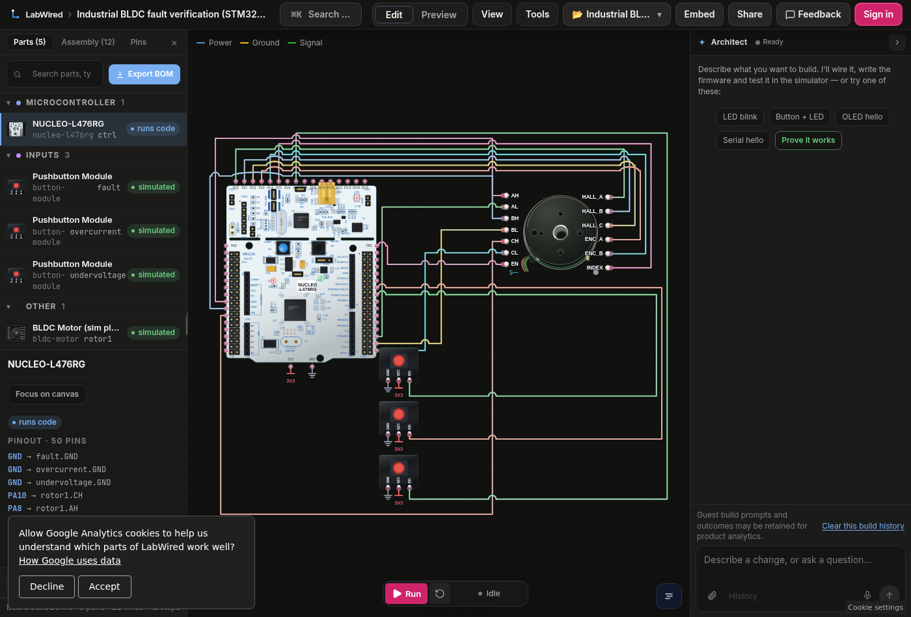

# Industrial motor-controller verification — STM32L476

**Live runnable LabWired project:** [Open the 24 V BLDC drive and three fault inputs](https://app.labwired.com/?share=3qFhHMhZdvCo&run=1).

This is an **industrial safety-path demonstration**, not a production-qualified inverter. It uses the existing LabWired STM32L476 model and generic BLDC plant. No simulator engine, application-specific MCP tool, or hardware stack was created for this demo.

## Why a manufacturer should care

A firmware change should not make a drive ignore a fault signal. This lab executes compiled Cortex-M4 firmware against a 24 V reduced-order motor plant. The real six-step controller code, TIM1 complementary outputs, inverter enable, Hall feedback, encoder feedback, and three independent GPIO fault flags are inspectable. Each fault is driven through an input component, not by injecting fake UART messages.

**Try it:** open the lab; run the firmware; view its UART and motor feedback; activate one fault input (DRIVER FAULT, OVERCURRENT, or UNDERVOLTAGE). Restart before trying another fault: this demonstration latches a safe shutdown. The three fault flags are **digital inputs**, not measured power-stage waveforms.

## Verified scenarios — 10 November 2026

| Scenario | Stimulus and required evidence | Simulator verdict |
| --- | --- | --- |
| Normal drive | UART `BLDC READY`, `TARGET REACHED`; motor reaches at least 100 RPM | `model_verified` (peak absolute speed 6,189.7 RPM) |
| Driver fault | Input `fault.pressed=1` at cycle 1,250,000; `FAULT DRIVER`, `INVERTER OFF` and `PB0=low` | `model_verified` |
| Overcurrent flag | Input `overcurrent.pressed=1` at cycle 1,250,000; `FAULT OVERCURRENT`, `INVERTER OFF` and `PB0=low` | `model_verified` |
| Undervoltage flag | Input `undervoltage.pressed=1` at cycle 1,250,000; `FAULT UNDERVOLTAGE`, `INVERTER OFF` and `PB0=low` | `model_verified` |

All three fault stimuli were recorded as `applied`. The hosted C compiler rebuilt the exact source with ELF ref `sha256:c6e69803a9b95ebf3f12b2d141059b2e206a6b9ce5ce7cd53e369da0a50cf3e5`. Validation returned **0 errors and 9 `PIN_LACKS_PWM` warnings**. Those warnings are not silently suppressed.

## Reproduce using existing generic LabWired tools

1. Pass [the existing firmware source](../../robotics/quadrotor-bldc/firmware/main.c) to `labwired_compile` (`board=stm32l476`, `language=c`, `entryPath=src/main.c`). **The firmware source is intentionally shared** with the existing quadrotor one-motor model to avoid a duplicate test application. It is a custom six-step controller, not ODrive code.
2. Use [the LabWired circuit JSON](labwired/circuit.json) with `labwired_validate` and `labwired_verify`. The MCU is `ctrl`; motor is `rotor1`; three button input components are `fault`, `overcurrent`, `undervoltage` on `PB7`, `PB6`, and `PC7` respectively.
3. Run the four oracles and fault stimuli documented in [evidence.json](labwired/evidence.json). Run each fault in a separate fresh simulation. A pass must show the exact fault marker **and** `INVERTER OFF` **and** `PB0=low`.
4. Compare observed outputs with a physical drive before making any hardware safety claim. That physical comparison has **not** been completed.

## Scope and gaps

**Verified:** firmware compilation, normal spin-up, target detection, three distinct digital-fault inputs, and model-observed inverter-enable shutdown.

**Not verified:** real PCB electrical design, transistor switching, analog current/voltage sensing, MCU brownout, motor heating, load dynamics under physical stress, physical-device behavior, functional-safety certification, or automated compliance reports. The MCU has an ideal 3.3 V rail; the UNDERVOLTAGE button is **not** a power supply transient. The motor is a reduced-order plant. Live browser rendering and hosted simulation were separately checked; the regression oracle is the authoritative proof.

The engine-side [BLDC example](https://github.com/w1ne/labwired-core/tree/main/examples/nucleo-l476rg-bldc) includes a separate mechanical-stall scenario and a shutdown-latency oracle. That scenario is not represented as passing in this three-button Studio demo.

