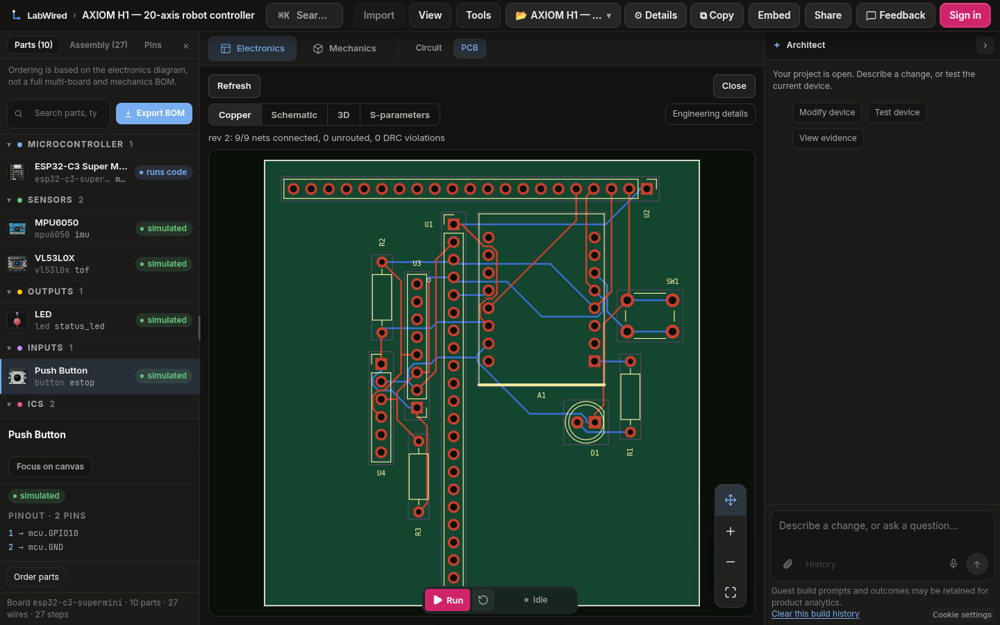

# AXIOM H1 robot controller

This example is exported from a **real saved LabWired project**, not a proposed design.

- [Open the original project in LabWired](https://app.labwired.com/p/e6b30d45ba55e64aa450a2aa292edd4b/edit)
- [Project source, diagram, stimuli and oracle input](project.input.json)
- [Revision-pinned saved evidence](evidence.json)
- Board: `esp32-c3-supermini`
- Saved content hash: `3fbbe85932524caaf21b5f63d2c2333e177c32320d4e162370c288964cd7cfb3`
- Original simulator evidence on this exact revision: **model_verified**
- Individual saved requirement results: **3/3 verified**

## Reproduce

1. Inspect `project.input.json`, which contains the original editable firmware source, circuit/netlist, input stimuli and explicit verification requirements.
2. Use LabWired's `labwired_project_create` with the input fields, or open the original saved project above. The imported copy is **unlisted**, and it does not automatically inherit a PCB, CAD attachment or verification receipt.
3. Run `labwired_project_verify` against the copied project with the saved requirements. Inspect the returned exact content hash and all clause results. Do not treat compilation alone as verified.
4. Inspect PCB and mechanical artifacts separately in the original project; record a fresh verification when changing firmware, wiring, source, or CAD identity.

## Proven boundary

PCA9685 register writes and sensor/controller behavior are verified; PCA9685-driven servo motion, firmware-to-MuJoCo coupling and physical robot response are not.

The linked PCB/CAD items, if present, are **not** reconstructed by the project-input import. The `evidence.json` file is a readback of the original saved project on 2026-11-21, not a promise that any future deployment or new copy has passed.

## Explicit 20-servo topology candidate (not yet a verified model)

[Open `20-servo-candidate.json`](20-servo-candidate.json). It is based on the *same saved firmware and original circuit* but adds 20 distinct servo-twin signal loads connected to PCA9685 channels 0–15 at `0x40` and channels 0–3 at `0x41`. Both output-enable pins remain connected to ESP32-C3 GPIO3/GPIO4. The source's exact joint-name ordering is preserved. `node scripts/check-axiom-servo-candidate.mjs` checks source identity, each physical wire pair, unique channel mapping and a disconnected-channel negative control.

A **local compile with the pending PCA9685 runtime branch** emitted 20 servo models and 20 dynamic OE bindings with zero compile errors. It also returned 20 `PWR_SUPPLY_UNCONNECTED` advisories and 20 `SERVO_PCA_COVERAGE` warnings. The default `sg90` model is a simulation surrogate, **not** a calibrated AXIOM humanoid actuator. There is no modeled servo supply rail, accepted KernelCAD joint graph, coupled MuJoCo physics, live deployment, or physical verification. The original saved AXIOM project is unchanged. The new candidate is a distinct unlisted project, with a current controller-only verification receipt.

**21 Nov 2026 live progress:** The source-bound powered 31-part/88-wire candidate has now been saved as an **unlisted LabWired project**: [open the AXIOM 20-servo candidate](https://app.labwired.com/p/dab8622b41adbf3b9e2175909146b207/edit). The [live snapshot](live-20-servo-evidence.json) records a current matching-hash **model_verified** result for the *three original controller/serial requirements*, not for servo actuation. This supersedes the earlier sentence that the candidate had not been saved. Missing external servo supply, deployed PCA output models, controlled joint motion and collision-safe CAD remain open.

## Regulated servo rail (21 November 2026)

The [current exported input](20-servo-powered-input.json) is the **same unlisted LabWired project** with one modeled independent 5 V supply (`servo_rail`), 20 added servo VCC wires and one shared MCU ground wire. The original controller source, 20 PWM mapping wires, OE GPIO assignments, four input stimuli and three requirements remain byte-identical. Live `labwired_validate` reports **0 errors, 20 `SERVO_EXPANDER_UNMODELED` warnings, 0 `PWR_SUPPLY_UNCONNECTED` warnings**. An explicit hosted rerun returned **3/3 controller-only `model_verified`** on saved hash `386b3ec5442960f58e4ed8c383810ca704af76de657256ce831ff8fbc6112548`. The model assumes an ideal regulated 5 V rail; **no real current capability, dynamic sag, torque, mechanical movement or collision safety** was verified. The original unpowered 30-part candidate remains in `20-servo-candidate.json` as a baseline; it is not the currently saved live revision.

## Live Studio screenshot — 21 November 2026

[Source-pinned live screenshot and independent verification scope](../../flagship-live-snapshots-20261121.json). Original 10-part project PCB with 9/9 nets connected; not the 31-part servo candidate. No PCA-to-servo motion, MuJoCo coupling, fit or physical proof.
