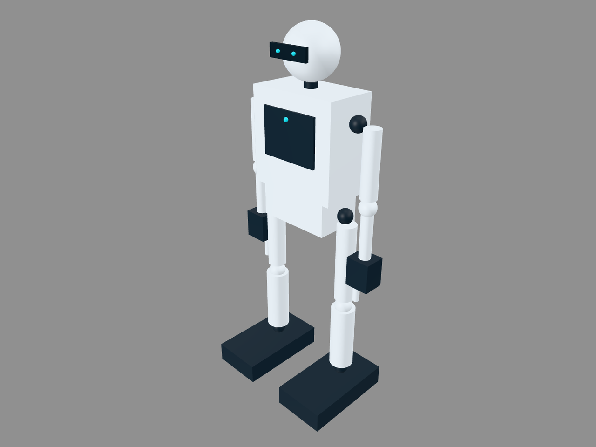
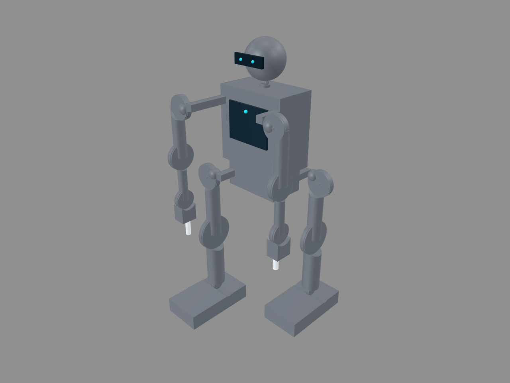
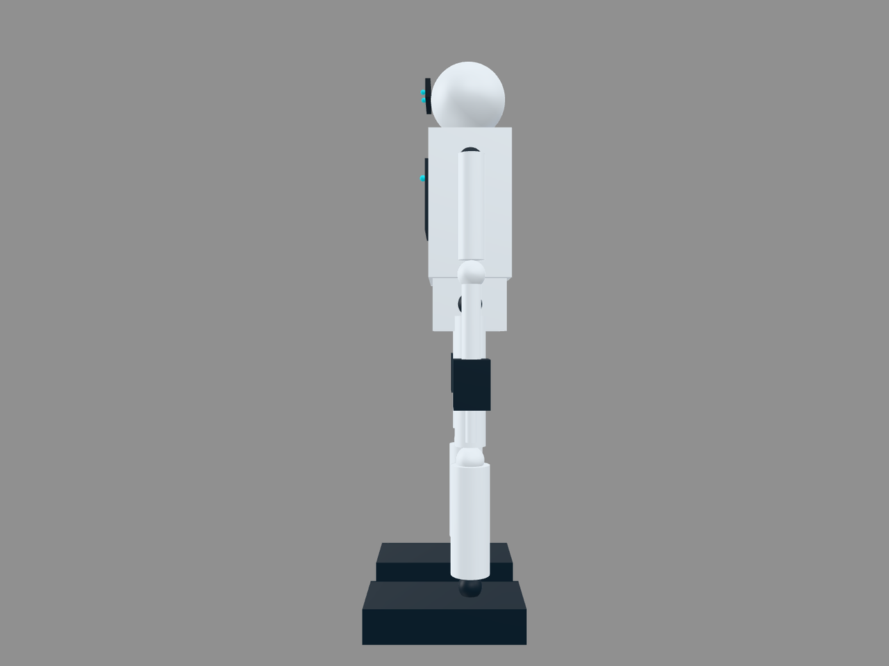
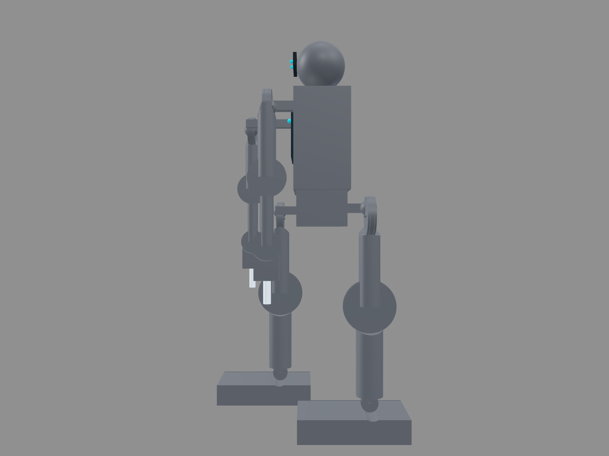

# AXIOM H1 robot controller

The original saved AXIOM project now contains **20 explicitly wired servo models** and an ideal external 5 V rail. The unchanged ESP32-C3 firmware drove all 20 channels in a local run of the real simulator. Three channels changed angle during its wave sequence. Proximity and tilt faults disabled both PCA banks and recovered. Emergency stop remained latched after release.

- [Open the original LabWired project](https://app.labwired.com/p/e6b30d45ba55e64aa450a2aa292edd4b/edit).
- Current source: [current-project.input.json](current-project.input.json), 31 parts and 88 wires.
- Current saved hash: `0487080a9c2eaf9e45fd2fbad8ad42603fdffc09a0aac2ff9bca0146c6d785ee`.
- [Promotion receipt](original-project-promotion.json): the guarded update preserved firmware, metadata, media and `pcb_172fd76a950f0bd9` revision 2.
- **Hosted acceptance is pending.** The three earlier controller requirements became stale after the diagram update. The local result below does not establish deployed servo support.

The linked PCB is the existing controller board. It does not include the added servo loads or external servo rail.

The [22 November hosted recheck](../../flagship-hosted-recheck-20261122.json) confirms that the current original project still has three **stale** controller oracles after its diagram update. A separate candidate has 3/3 controller-serial oracles on its own hash, but no hosted PCA9685-to-joint motion proof. Dependencies remain [#3676](https://github.com/w1ne/labwired/pull/3676) and [#3677](https://github.com/w1ne/labwired/pull/3677).

## Firmware-driven actuator evidence — 21 November 2026

[Runtime receipt](actuator-runtime-evidence.json) records 185,000,000 instructions through the real `WasmSimulator`, using app-generated YAML and the exact saved Arduino source. Inputs used the existing `set_inputs` API. The test did not write PCA registers or output-enable GPIO registers directly.

| Check | Observed result |
| --- | --- |
| Startup | All 20 command states started inactive, with zero pulse width. |
| Valid firmware output | All 20 became active with `source_status: modeled_pwm` and nonzero pulse widths. |
| Neck yaw, `servo0` | Modeled angle changed from 95.9495° to 108.4320°. |
| Left shoulder pitch, `servo2` | Modeled angle changed from 95.9495° to 74.2206°. |
| Left elbow, `servo4` | Modeled angle changed from 10.4211° to 86.7032°. |
| Proximity input: 100 mm | All 20 sources became disabled. Commands remained unchanged during an additional 5,000,000 instructions. Restoring 1500 mm re-enabled output. |
| Tilt input: ax = 1 g, az = 1 g | All sources became disabled. Restoring ax = 0 g, az = 1 g re-enabled output. |
| Emergency stop | All sources became disabled. Releasing the button kept the firmware latch and commands unchanged. |
| Remove the `servo19` PWM wire | The compiler omitted that servo model and reported a floating input and no MCU signal path. |

These angles are the SG90 model's pulse interpretation. They are not calibrated AXIOM joint angles. `active` and angle retain the last modeled command when output-enable goes high; `source_status` reports the modeled source configuration. Servo current, voltage sag, torque and physical hardware are outside this evidence.

### Reproduce the local run

[Input provenance](actuator-runtime-inputs.json) pins the unchanged source hash, four hosted compile blobs and their flash offsets. It also identifies the successful exact-core WASM workflow [44580096395](https://github.com/w1ne/labwired-core/actions/runs/44580096395), artifact `exact-core-5af794-wasm-glue`, core `5af794255a13949c3d3e1e0f0f3f6723579e1253`.

1. Build `packages/board-config` in the recorded LabWired app revision from the runtime receipt.
2. Download the named WASM artifact and verify its `SHA256SUMS` against the corresponding basenames. Its manifest records absolute CI paths.
3. Download the four content-addressed blobs listed in `actuator-runtime-inputs.json`. Verify each SHA-256. Place each at its recorded offset in a 4 MiB flash image filled with `0xff`. Verify `combined_flash_sha256`.
4. Run the bounded source acceptance script:

```sh
node scripts/check-axiom-actuator-runtime.mjs \
  --app /path/to/labwired \
  --wasm /path/to/exact-core-5af794-wasm-glue \
  --flash /path/to/combined-flash.bin \
  --output /path/to/axiom-runtime-receipt.json
```

The script checks all 20 channel identities, changing commands, fault recovery, the E-stop latch and disconnected-signal rejection. It writes a failure receipt if an assertion fails. It keeps the simulator's default peripheral tick interval of one and records flash fast-start use.

## Mechanical integration — command motion passes, physical acceptance fails

The revised [AXIOM H1 staggered frame, revision 1](https://app.kernelcad.com/p/45f5VM8t?version=1) has **27 parts, 20 revolute mates and six fastened mates**. The saved source is [axiom-compact-frame.kcad.ts](mechanical/axiom-compact-frame.kcad.ts), SHA-256 `5c392121b7cccfd8dc41fb0226ac68e3f344b06bf954ccb35db74e0fd9ac4496`. The immutable saved revision was read back and matched those exact bytes.

The [full evaluation](mechanical/compact-frame-evaluation.json) checked **59 sampled poses across all 20 source joint ranges**. All mates remained satisfied, no sampled collisions occurred, and fastened parts remained rigid. No joint range was reduced and no collision pair was ignored. This discrete check does not establish every continuous path or simultaneous joint combination.

### Current mesh artifact — 22 November 2026

The provider regenerated the revision-1 mesh under provenance `613a4609e40d62c218cd4e276c3bf5835525feb1e068a64acd18a1e6fd1a89ea`. The source and all 20 bindings are unchanged. The [artifact qualification](mechanical/artifact-refresh-20261122/qualification.json) repeats the original evaluator check on server `eb097a77bc0e`: **59 poses, 20 joints, zero sampled collisions**. The [pose manifest](mechanical/artifact-refresh-20261122/pose-coverage.json) records every pose and the deployed enumeration source hashes.

The [current model reference](mechanical/artifact-refresh-20261122/model.json) is qualified for logical CAD binding. The original saved LabWired project still awaits the deployed v2 binding schema and its guarded mechanical update. Physical acceptance remains failed.

The exact [mesh archive](mechanical/artifact-refresh-20261122/mesh.json.gz) contains 27 parts, 38,604 vertices and 43,356 triangles. Its decompressed length is 3,107,233 bytes and SHA-256 is `aaa16db035e4563a94fd3a7e236fe50bcc048f5ef731564912a9083b54e8b8e5`. This archive retains the tested bytes independently of later provider repairs.

The previous `091c0eb4…` stored-only API returned HTTP 404. Its CDN URL returned HTTP 200 with the **new** artifact bytes. The [stored-artifact readback](mechanical/artifact-refresh-20261122/stored-artifact-readback.json) and [old-CDN readback](mechanical/artifact-refresh-20261122/old-cdn-pin-readback.json) preserve both observations. This evidence bundle does not contain the old mesh bytes; byte or triangulation equivalence is not claimed. The original model, review, evaluation and renders remain as historical evidence.

The existing transform proof also passes with the actual mesh features as its baseline. All 20 bindings and all 46 firmware samples pass the same affine oracle. The final 44 matrix samples exactly match the source-only proof. At the first two samples, no actuator command exists: the real mesh has explicit identity transforms, while the original mock baseline has no transforms. With missing rest transforms normalized to identity, all 46 samples match. Consequently, 23 parts change from the authored rest pose to their initial commanded pose; 10 parts vary after the first command observation. These are different measurements. Both [source-runtime](mechanical/artifact-refresh-20261122/joint-transform.json.gz) and [actual-mesh](mechanical/artifact-refresh-20261122/mesh-transform.json.gz) receipts are retained.

Reproduce the actual-mesh proof with the app and kernelCAD-app commits recorded in the qualification:

```sh
node scripts/check-axiom-joint-transforms.mjs \
  --app /path/to/labwired \
  --kernelcad-app /path/to/kernelCAD-app \
  --model examples/robotics/axiom-h1/mechanical/artifact-refresh-20261122/model.json \
  --mesh examples/robotics/axiom-h1/mechanical/artifact-refresh-20261122/mesh.json.gz \
  --mesh-sha256 aaa16db035e4563a94fd3a7e236fe50bcc048f5ef731564912a9083b54e8b8e5 \
  --output /path/to/mesh-joint-transform.json
```

The replay rejects a wrong mesh content hash or the old provenance pin before writing a success receipt. It uses the same production runtime source and affine oracle as the original proof. Browser paint, physical loads and deployed project acceptance remain outside this result.

A separate `verify(check:"swept-collision", range_samples:3)` request timed out at 300 seconds. That wrapper does not use `range_samples`; it starts the default 1-degree sweep. This [failed additional check](mechanical/artifact-refresh-20261122/additional-dense-sweep-time-limit.json) is preserved separately. The original 59-pose evaluator check passed. Neither result establishes every continuous path or every simultaneous joint combination.

### Geometry changes

The original [QC9kIRT9 version 1](https://app.kernelcad.com/p/QC9kIRT9?version=1) and its [source](mechanical/QC9kIRT9-v1.kcad.ts) remain unchanged. Its helper functions declared connectors but made zero `robot.mate` calls. Adding the real graph exposed intersecting joint envelopes and connectors outside their bodies. The new frame adds cleared fork-and-tongue joints, connects the ankle and neck gaps, and moves the bearing mounts onto connected material.

| Property | Original source | Revised frame |
| --- | ---: | ---: |
| Width × depth × height | 393 × 230 × 874 mm | 375 × 430 × 873 mm |
| Shoulder fore/aft positions | Both y = 0 mm | Left −115 mm; right −175 mm |
| Hip fore/aft positions | Both y = 0 mm | Left +100 mm; right −100 mm |
| Hip roll pivot, absolute x | 126 mm | 135 mm |
| Hip roll pivot, z | 480 mm | 462 mm |
| Thigh/shin center, absolute x | 114 mm | 123 mm |
| Palm width | 58 mm | 40 mm |
| Gripper offset from palm center | 18 mm | 9 mm |
| Uniform solid ABS mass estimate | 15.02526 kg | 15.02686 kg |
| Estimated center of mass, x/y/z | 0 / −8.282 / 448.939 mm | −0.189 / −18.453 / 449.690 mm |

The +200 mm depth is a deliberate structural revision. It separates the limb workspaces while retaining the original torso size and limb lengths. The source shoulder-roll limits are now −70°/+80° on the left and −80°/+70° on the right. Both are derived from firmware; the original CAD used ±75°.

The mass calculation applies **1040 kg/m³ to solid ABS envelopes**. It is not the mass of a hollow, manufactured robot with installed actuators, bearings, wiring and battery. The [review receipt](mechanical/compact-frame-review.json) includes both mass-property results, bounds, source identity, render provenance and the failed physical checks.

| Original geometry | Revised geometry |
| --- | --- |
|  |  |
|  |  |

[Original front view](media/original-frame-front.png) and [revised front view](media/compact-frame-front.png) complete the inspected canonical views. These images came from the real kernelCAD renderer. An earlier 1208 mm wide clearance diagnostic was rejected and is not the delivered frame.

### Firmware pulse → joint → CAD transform

The [joint-transform receipt](mechanical/joint-transform-evidence.json) passes against the exact saved compact source. It replays the 46 snapshots from the real 185-million-instruction firmware run through the production LabWired `KernelCadRuntimeHost`, kernelCAD `ElectronicsRuntimeStore` and `motionGeometries`.

- All 20 component bindings are acknowledged. Their 23 dynamic parts have unique ownership and a parent motion hierarchy.
- The map derives from the unchanged firmware's names and `jmin`/`jmax` arrays. PCA prescale 121 and counts 110–500 correspond to 536.8–2440 µs. These source-derived endpoints are command mappings, not measured servo calibration.
- The three changing firmware commands move 10 dependent CAD parts, including the head visor/eyes and the full left arm chain.
- The production affine matrices match an independent axis-angle calculation at four reference points per moving part. Maximum error is 1.93 × 10⁻¹³ mm.
- Disabled output reports a source fault and retains the last command pose. E-stop release remains latched. The receipt does not claim that real unpowered joints retain their position.

The [historical LabWired model reference](mechanical/compact-frame-model.json) preserves all 20 bindings and the original mesh provenance. Use the [qualified current reference](mechanical/artifact-refresh-20261122/model.json) for the pending integration. [Derived electronics mappings](mechanical/source-derived-electronics.json) are also available separately. At this receipt's creation, the original LabWired project had the powered servo topology but had not yet received this mechanical reference. Hosted integration still depends on the pulse mapping implementation in [LabWired PR #3677](https://github.com/w1ne/labwired/pull/3677).

Reproduce the transform proof with the app and kernelCAD-app commits recorded in the receipt:

```sh
node scripts/check-axiom-joint-transforms.mjs \
  --app /path/to/labwired \
  --kernelcad-app /path/to/kernelCAD-app \
  --output /path/to/joint-transform-evidence.json
```

The script uses existing production runtimes and the stored firmware run. It does not create a simulator or write MCU registers. It verifies the saved source hash and bindings before writing the receipt. Browser paint remains outside this proof.

### Physical acceptance failures

**Physical robot acceptance is failed.** The controller and affine motion evidence do not establish lifting, balance or actuator sizing.

1. **Actuator travel mismatch.** The diagram uses SG90 command proxies. [TowerPro's official SG90 page](https://towerpro.com.tw/product/sg90-7/) states in the manufacturer's range response that normal servos operate from 0° to 150° unless a wider range is specified. The AXIOM source spans 185° at both shoulder-pitch joints and 165° at both hip-pitch joints. No matching actuator or transmission is declared.
2. **No load or holding coverage.** Generic `verify(check:"motion-load", motion_mode:"range", quasi_static:true)` returned zero joints and zero samples because no `mechanicalJoint` drive contracts exist. Generic `static-hold` also returned zero joints and zero poses. Their `ok:true` fields are not an acceptance result.
3. **No installed actuator/load model.** The same manufacturer page lists 9 g and a 1.8 kgf·cm stall rating at 4.8 V, equivalent to 0.1765197 N·m. A stall rating is not a continuous holding rating. The frame has no actuator mounting, shaft/support contract, measured mass distribution, torque/current model or validated transmission.
4. **No physical dynamics proof.** Gravity response, ground contact, balance, friction, deflection, thermal behavior, rail sag and drop on release remain unverified.

The generic `design_loop` and `review_cad` wrappers returned an internal vendor-evaluator error on this source. Their correlation IDs are retained in the review receipt. Direct full evaluation, canonical rendering, saved mesh generation and the independent runtime transform proof completed; no successful wrapper review is claimed.


## Earlier source and hosted receipts

[project.input.json](project.input.json) and [evidence.json](evidence.json) preserve the original 10-part/27-wire controller revision. Its three serial requirements were verified on hash `3fbbe85932524caaf21b5f63d2c2333e177c32320d4e162370c288964cd7cfb3`.

[20-servo-candidate.json](20-servo-candidate.json) preserves the unpowered topology baseline. [20-servo-powered-input.json](20-servo-powered-input.json) adds the ideal 5 V rail and is the exact runtime input. The [separate candidate project](https://app.labwired.com/p/dab8622b41adbf3b9e2175909146b207/edit) retains its [controller-only hosted receipt](live-20-servo-evidence.json), hash `386b3ec5442960f58e4ed8c383810ca704af76de657256ce831ff8fbc6112548`. That earlier deployment reported 20 `SERVO_EXPANDER_UNMODELED` warnings and zero unconnected-supply warnings.

To make a new saved copy, use `labwired_project_create` with `current-project.input.json`. It does not inherit PCB, CAD, media or verification records. Run `labwired_project_verify` against the exact saved revision after the required runtime is deployed.

## Earlier live Studio screenshot


[Source-pinned screenshot and scope](../../flagship-live-snapshots-20261121.json). This shows the original controller PCB with 9/9 nets connected. It does not show the newly added servo loads or mechanical motion.
