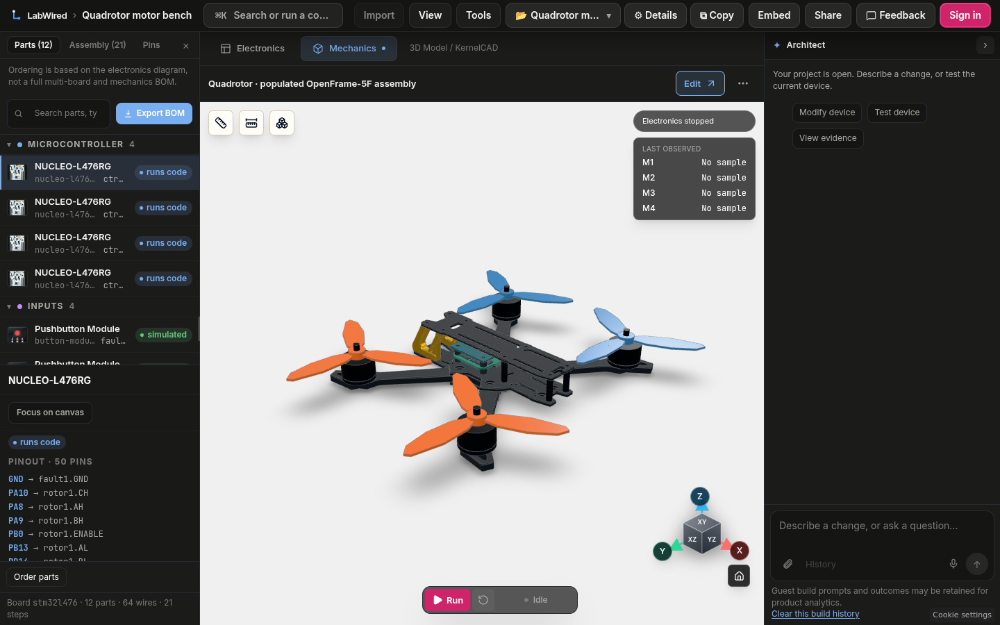

# Quadrotor co-design: LabWired + KernelCAD

This package contains a versioned **KernelCAD assembly**, a real **six-layer OpenESC schematic and PCB**, and a **four-channel STM32 propulsion bench**. The motor bench uses real compiled firmware and reduced-order motor models. It does not yet simulate the electronics or flight controller on the physical boards.

## Native five-controller flight acceptance — 22 November 2026

The [source-bound native flight candidate](labwired/evidence/20261122-native-flight/README.md) now passes a 15-second run with measured takeoff, 2.68 seconds of hover within 0.85–1.15 m, roll/pitch/yaw tracking and 1.87 seconds of attitude recovery. A smaller-poll replay also passes. Five separate compiled STM32L476 ELFs drive the existing native motors, body and BMI270 feedback loop with the declared propeller shaft load.

All five fault cases pass: the external driver-fault button and native inverter, overcurrent, undervoltage and stall inputs cause latched all-motor shutdown and model ground contact. Every case has 391 post-clear-attempt observations with the outputs proven off. Native overcurrent rejects clearing, and its receipt records that distinction. This establishes shutdown and ground contact within the model, without a controlled-landing or physical-aircraft claim.

[Exact sources, archived ELFs/WASM, trace audit and failed-candidate history](labwired/evidence/20261122-native-flight/README.md) · [Machine-readable acceptance](labwired/evidence/20261122-native-flight/acceptance.json) · [App integration PR #3967](https://github.com/w1ne/labwired/pull/3967). The published four-channel reference is unchanged. Saved-project promotion and hosted/browser flight verification remain pending integration and deployment.

## Hosted saved-project checkpoint — 22 November 2026

The [22 November hosted recheck](../../flagship-hosted-recheck-20261122.json) records the exact new 4/4 Hall-lock run, a builder SIGKILL interruption that initially cleared same-hash proof, and an independent 4/4 single-ESC fault control. The succeeding verification restored fresh saved proof. Neither result establishes measured flight.

The [22 November authenticated UI readback](../../flagship-ui-readbacks-20261122.json) includes a [fresh screenshot of the original circuit and Architect warning](media/live-readback/quadrotor-original-ui-20261122.jpg). The UI did **not** produce a fresh Hall-lock world-verification result in this capture. Earlier 4/4 verified runs remain historical model evidence; no aircraft motion is proved.

**Latest current readback, 22 November 14:13 UTC:** the [authenticated saved-project and media receipt](../../flagship-live-current-20261122.json) confirms the original quadrotor at **4/4 current model-verified** Hall-lock requirements, with `content_hash == verified_hash` (`1c89a2f8…f1524ecc`). The separate single-ESC fault-control project is **4/4 current model-verified** on its own hash. The [new screenshot of the five-controller circuit](media/quadrotor-live-circuit-20261122.png) was also uploaded to the [original project media](https://api.labwired.com/v1/projects/7c92d38a4f2ac205aa91502291fde0d8/media/89fffdfc7516f4a9fd05777e/raw) and confirmed by media readback. The circuit screenshot and serial checks do not establish live six-axis flight, coupled flight-fault response or physical aircraft operation. The older UI warning belongs to the earlier capture, not this server-side verification state.

**Fresh 22 November 17:32 UTC hosted rerun:** the exact saved five-controller project passes **4/4 Hall-lock oracle clauses**, run `world-job:28888d15-4100-468c-98de-4ff35589f85e`. The separate single-ESC injected-fault project independently passes **4/4** shutdown clauses. The [current immutable receipt](../../flagship-fresh-hosted-reverify-20261122.json) records both identical content/verified hashes. This still does not verify hosted six-axis flight or physical hardware.

## Separate five-controller live LabWired twin — 21 November 2026

The [saved five-controller LabWired project](https://app.labwired.com/p/7c92d38a4f2ac205aa91502291fde0d8/edit) runs one STM32L476 flight controller with a BMI270 model, plus four STM32L476 ESC controllers and four simulated BLDC motors. On the **21 November saved revision**, hosted verification at 2,000,000 steps passed **four of four** independent Hall-lock serial assertions. The FC reported BMI270 online, arm command and takeoff **command**, but no sensor-measured takeoff, hover, flight-control stability or physical-hardware acceptance.

A separate [single-channel safety campaign](https://app.labwired.com/p/8beab229c9d4ed650ccbdc8725c233cc/edit) passed **four of four** assertions: Hall-lock before injected fault, driver fault recognition, latched inverter-off marker and PB0 output low. It does not demonstrate a coupled four-motor in-flight failsafe. Source hash, saved project IDs, explicit oracle clauses and [live proof readback](labwired/evidence/20261121-five-controller-hosted-proof.json) are pinned here. Keep this experimental five-controller target separate from the four-channel published reference and the actual native ESC/FC hardware.

## New five-MCU saved projects — 21 November 2026

A second live [five-controller safety-wiring project](https://app.labwired.com/p/2260a09dcf2b05f195b169a0180d5f54/edit) contains the exact **17 parts and 81 wires** of the [source-bound flight-candidate PR #34](https://github.com/w1ne/labwired-examples/pull/34): 5 separately compiled STM32L476 firmwares, 4 BLDC motor plants, BMI270, four ESC fault inputs, and the FC emergency-stop switch on PC4 with PB6/PB7 I²C pull-ups. An original [16-part staging project](https://app.labwired.com/p/701c988648a93ef187b74ede9d6544c6/edit) was separately repaired in place with the same five exact firmware sources and kept for regression comparison.

**Both** saved projects now have fresh, revision-matching **4/4 model-verified Hall-lock** requirements with original individual controller serial output. Exact project hashes, run IDs, scope and limitations are recorded in [the 21 November hosted receipt](labwired/evidence/20261121-five-controller-live.json). The validation script `node scripts/check-five-controller-live.mjs` checks the evidence metadata. It does not run firmware.

A separate **five-controller test-only driver-fault campaign** now also passed **9/9 direct serial oracles** (`world-job:1e04d462-bfb8-42c8-9f5f-b44672fe53af`): ESC1 detected and latched the injected fault; the flight controller reported all-motor disarm, and ESC2–4 reported disarmed. This uses an FC PC12 → ESC1 PB7 injected-fault fixture rather than the saved normal-flight source. No motor-force, attitude or safe-landing result is inferred. The full clause manifest and test scope are in the same [live receipt](labwired/evidence/20261121-five-controller-live.json).

These are successful **five-controller propulsion/control firmware** tests. A printed `FC TAKEOFF COMMAND` is not measured flight. At that checkpoint, six-DOF body translation, hover and attitude recovery were still open; the 22 November native candidate above now supplies those modeled results. **Model-to-native ESC equivalence, battery/power and physical flight remain open.** The full-flight candidate source in PR #34 remains draft for those gates. Keep it separate from the four-channel published reference.

## Native FC mechanical candidate, 12 November 2026

The [current CAD source and evidence](cad/README.md) replace the FC envelope with
the repaired native PCB and all 107 assigned component models. Hosted evaluation
passes with 38 parts and 37 mates. Conservative geometric checks cover 31
external pairs and 652 FC-component/support-ring pairs. The candidate is saved as
[KernelCAD revision 5](https://app.kernelcad.com/p/DyJ405zg?version=5). The
published firmware bench remains a separate electrical target; native electrical
onboarding is tracked in [LabWired PR #3148](https://github.com/w1ne/labwired/pull/3148).

## Five-controller flight integration candidate (14 November 2026)

The [five-controller circuit](labwired/five-controller-flight-circuit.json) adds a compiled STM32L476 flight controller, four command-driven ESCs, four motor plants, individual fault inputs, a BMI270 inertial sensor, and universal mixed-signal instruments. The [source manifest](labwired/five-controller-flight-project.json) pins the five firmware images and [KernelCAD revision 5](https://app.kernelcad.com/p/DyJ405zg?version=5). This candidate is separate from the public four-channel propulsion bench.

The [compilation receipt](labwired/evidence/20261113-production/five-controller-compilation.json) records five successful hosted compiles before the changes in this branch. Source hashes and compiler receipts must be regenerated after any firmware changes. The intended shared runtime consumes measured motor state, integrates bounded six-degree-of-freedom dynamics and feeds IMU values to the flight controller. **It does not establish closed-loop flight proof until a five-firmware runtime trace, behavior oracles, and browser replay pass on the deployed revision.** This candidate does not run native RP2354B or AT32F421 firmware.

## Latest technical video — native routing edits and mixed-signal fault run (13 November 2026)

[Watch the 32-second quadcopter review](media/labwired-quadcopter-routing-mixed-signal-32s.mp4). The sequence shows actual KiCad-native copper edits, a populated 3D ESC board, synchronized real hosted PWM/Hall/model-current/fault traces, and a separately captured motor digital twin. Five native PCB DRC stages count 12, 9, 6, 3 and 0 open connections, all with zero other configured DRC violations. The real-hosted simulation measures 20 kHz PWM at 60% duty and a 1.95225-ms modeled fault-to-inverter-disable interval.

The PCB edits restored source-approved geometry, not a novel autoroute. The electrical run is a reduced-order 24-V STM32L476/BLDC test, not the physical AT32F421 ESC or flight. [Raw signals, DRC evidence and provenance](media/evidence/native-routing-mixed-signal-20261113/README.md).

## Previous video: PCB routing reveal, 3D board and digital twin (13 November 2026)

[Watch the 32-second LabWired quadcopter video](media/labwired-quadrotor-pcb-digital-twin-32s.mp4). Five readable scenes: parametric CAD, six-layer PCB routing, a rotating populated 3D board, the live oscilloscope and logic analyzer shown together, and the operating quadcopter digital twin. No separate safety scene, controller-count story, or unrelated instrument captures. The PCB routing animation progressively reveals the completed source geometry; it does not imply a recorded autorouter operation. [Exact source and timing record](media/labwired-quadrotor-pcb-digital-twin-32s.provenance.json).

## New: focused quadcopter digital-twin demonstration (13 November 2026)

[Watch the 39.5-second LabWired film](media/labwired-quadrotor-focused-demo-short.mp4). Seven focused scenes show the 3D quadcopter, native PCB, four compiled motor controllers, actual quadrotor oscilloscope and logic-analyzer signals, and one driver-fault shutdown. Shots stay on screen for 4.5–8 seconds with no title cards or black fades. [Exact source and timing evidence](media/labwired-quadrotor-focused-demo-short.provenance.json). This is motor-bench validation, not aircraft-flight validation.

## Engineering-superintelligence demonstration

[Watch the 44-second flagship video](media/labwired-engineering-superintelligence-quadrotor.mp4). It connects editable CAD, native PCB evidence, universal instruments, four compiled firmware controllers, deterministic motor plants, fault injection and selective shutdown in one sequence.

[Exact video provenance and reproduction](media/engineering-superintelligence-provenance.json) · [Media guide](media/README.md) · [Final runtime evidence](labwired/evidence/20261111-final/evidence.json)

The [75-second engineering source cut](media/quadrotor-engineering-preview.mp4) remains available for detailed review.

## Open the projects

- [Four-channel LabWired flagship project](https://app.labwired.com/p/34b9a67d8727b8b3a152d57ce22e5504/edit)
- [Channel-1 deterministic fault campaign](https://app.labwired.com/p/8beab229c9d4ed650ccbdc8725c233cc/edit)
- [KernelCAD populated OpenFrame-5F assembly, revision 5](https://app.kernelcad.com/p/DyJ405zg?version=5)
- [Complete system identity and model boundaries](system-integration.json)
- [Physical wiring and system BOM](hardware/assembly-wiring.md)
- [Native ESC schematic, PCB and manufacturing review](hardware/esc-4in1/)
- [Copied OpenFC-Lite repair revision 2-LW1](hardware/flight-controller-openfc-lite-rev2-lw1/) — zero active ERC/physical DRC errors and zero schematic/PCB parity differences; no native boot or manufacturing acceptance.

The saved flagship project links to KernelCAD revision 5. Its circuit contains four controllers, four motors, four independent fault inputs and 64 wires. Oscilloscope and logic-analyzer functions are universal Live Lab tools. They are not physical components of the aircraft.

## What the artifacts establish

| Artifact | Current scope | Evidence |
| --- | --- | --- |
| KernelCAD source | Pinned OpenFrame-5F rev2.2 frame, electronic stack, four rotor joints | [Mechanical checks and source identity](cad/README.md) |
| Physical OpenESC | Four AT32F421 controllers, four gate drivers, 24 MOSFETs; six copper layers | [Native electrical/layout review](hardware/esc-4in1/validation/) |
| Firmware bench | Four independent STM32L476 six-step commutators, Hall/encoder feedback, latched inverter shutdown | [Exact source and circuit manifest](labwired/four-channel-project.json) |
| Motor-to-CAD binding | Observed motor position/RPM mapped to explicit rotor/propeller groups | [Revision-pinned mapping](cad/runtime-bindings.json) |
| Native flight candidate | Five STM32L476 ELFs, native shaft load, body/IMU feedback, nominal and fault acceptance | [22 November native proof](labwired/evidence/20261122-native-flight/README.md) |
| Physical aircraft flight | Physical board, power and calibrated flight performance remain unvalidated | No physical-flight acceptance |

The CAD exploded view is an assembly illustration. The mechanism check samples rotor poses. Neither establishes a complete physical assembly path, frame strength or flight performance.

## Physical board and simulated bench

These are two distinct electrical targets. Keep this distinction visible in recordings and demonstrations.

| Property | Physical aircraft design | Published four-channel bench |
| --- | --- | --- |
| ESC MCU | Four AT32F421G8U7 | Four STM32L476 |
| ESC firmware | AM32 / DShot | Inspectable six-step commutator |
| Flight controller | RP2354B / Betaflight | Not running |
| DC supply | 4S LiPo: 14.8 V nominal, 16.8 V full | Ideal 24 V |
| Motor | EMAX ECO II 2306 2400KV | Reduced-order BLDC plant; Ke and Kt are both 0.04 in their SI units |
| Gate drivers and MOSFETs | Native schematic and PCB | Functional motor/inverter plant, no transistor transients |
| PCB-to-simulation equivalence | Required for a full hardware twin | Not established |

The native PCB has **222 footprints, 1,067 pads and 210 nets**. KiCad 10.0.8 reports zero ERC errors/warnings, zero DRC violations, zero unconnected items and zero schematic/PCB parity differences within the configured checks. The importer retains all components, nets and pin endpoints. However, **37 catalog entries remain unsupported for simulation**; nine further inert entries are connectors/testpoints. The actual board remains design-only. A clean rule check does not provide motor-current, thermal, switching-transient or flight evidence.

The populated visual assembly now passes hosted evaluation and rendering in [KernelCAD revision 4](https://app.kernelcad.com/p/DyJ405zg?version=4): 37 parts, 213 native KiCad component references and an exact substrate. Bounded native checks cover all 35 external PCB-to-part pairs. The stack lift gives 2.32 mm lower frame separation; 6 mm OD support rings remove a measured 0.0863 mm³ component overlap. This establishes the declared geometry fit, not solder, hardware, strength or flight acceptance. See [mechanical evidence and limits](cad/README.md).

## Reproduce the four-channel bench

1. Load [four-channel-circuit.json](labwired/four-channel-circuit.json).
2. Use the exact source identified for each controller in [four-channel-project.json](labwired/four-channel-project.json). Compile each as C with board `stm32l476` and entry path `src/main.c`.
3. Run all four controllers together. Their duty commands are 600, 640, 680 and 720 per mille. Require observed rotor motion and the firmware's Hall/encoder feedback markers.
4. Drive `fault1` through `fault4` independently. Require the selected controller's `FAULT DRIVER` and `INVERTER OFF` markers and its inverter-enable output low. Confirm that the other channels continue before faulting them.
5. Use `cad/runtime-bindings.json` for the evaluated KernelCAD revision. The bridge must receive real `positionRad` and `speedRpm`; a timed visual animation is not a substitute.
6. Pause and stop the simulation. Verify that the viewer stops advancing and does not reuse stale telemetry as a new run.

The multi-MCU loader correction [LabWired PR #3094](https://github.com/w1ne/labwired/pull/3094) merged after required CI passed. Hosted deployment and model verification are separate gates. The generic live bridge is in [LabWired PR #3106](https://github.com/w1ne/labwired/pull/3106) and [KernelCAD-app PR #121](https://github.com/w1ne/kernelCAD-app/pull/121). The candidate diagram with authored motion metadata is [four-channel-circuit.runtime-candidate.json](labwired/four-channel-circuit.runtime-candidate.json); it does not imply that production has deployed these changes.

## Observed candidate behavior

The [independent final audit](labwired/evidence/20261111-final/independent-audit.json) establishes:

- Four hosted compilations match the exact saved C sources. The four worker channels report their separate identifiers and duty commands.
- **360 of 360** received CAD motion observations match raw motor angle, RPM, control state and faults, with only the authored direction sign applied. No final-run observations are excluded.
- Fault1 disables M1 and remains latched after release. All **244** post-fault M1 observations are off; each other channel stays in inverter state for **243 of 243** observations before pause.
- Pause holds all four observed poses across at least five seconds and labels samples Last observed. Worker stepping stops.
- Reset reinitializes all four controllers and clears every motor sample. The receiver briefly reports stopped, then settles paused with no samples.

This is a browser candidate result, not a physical-board or flight result. The preserved receipts include source/ELF hashes, passive Worker and CAD frames, the exact recorder, and replayable Python audits. [Re-run the audit](labwired/evidence/20261111-final/README.md).

## Complete the physical hardware twin

The remaining work is concrete:

- Onboard the actual AT32F421 peripheral model and run the intended AM32 build.
- Run the RP2354B flight-controller firmware with IMU inputs and four DShot channels.
- Add the actual power stage, motor parameters, battery behavior and propeller loads. Calibrate them against component data and measured behavior.
- Connect forces and moments to the airframe dynamics, then test arming, command loss, attitude control and individual motor faults.
- Establish copper-to-model equivalence and a physical assembly/power-on validation record.

Use **engineering-superintelligence demo** for the complete LabWired workflow and **four-channel propulsion bench** for the verified simulation target. Do not describe this artifact as a flight-ready aircraft or as physical-board equivalence.

## Files and earlier evidence

- [firmware/channels/](firmware/channels/) stores the four exact saved-project sources, with SHA-256 digests in the project manifest.
- [cad/drone.kcad.ts](cad/drone.kcad.ts) contains the current native FC candidate and imports immutable source CAD.
- [cad/evidence/](cad/evidence/) contains full evaluation, motion, assembly-budget and export receipts.
- [hardware/esc-4in1/](hardware/esc-4in1/) contains editable native electrical files, local libraries and validation reports.
- [media/](media/) contains recordings and the scripts that produced them.

The original [35-second single-channel recording](media/quadrotor-demo.mp4), [single-channel circuit](labwired/circuit.json), [firmware](firmware/main.c) and [evidence](labwired/evidence.json) are retained as historical reference. They do not establish four-channel operation. The original motor test uses a simulated inverter; it does not run ODrive firmware or reproduce a proprietary ODrive PCB.

## Live Studio screenshot — 21 November 2026

[Source-pinned live screenshot and independent verification scope](../../flagship-live-snapshots-20261121.json). Static CAD screenshot. Motor M1-M4 read No sample while electronics stopped. No flight or current motor-motion evidence.

## Fresh multi-controller Hall and injected-fault recheck — 22 November 2026

The unchanged original saved four-controller project passed a new hosted **4/4 Hall-lock oracle** at 2,000,000 steps, run `world-job:218a1aca-e78c-47aa-827b-bf3274592210`. A fresh independent saved single-ESC injected-driver-fault test passed **4/4** including inverter shutdown and PB0 low; the synchronous service returned no run ID. Source hashes and requirement clauses are in the [immutable late recheck receipt](../../flagship-quadrotor-hall-reverify-20261122-2116z.json). The outcomes qualify simulated Hall commutation and a modeled single-ESC fault only, **not a six-axis flight controller, physical flight, or four-motor fault containment**.
