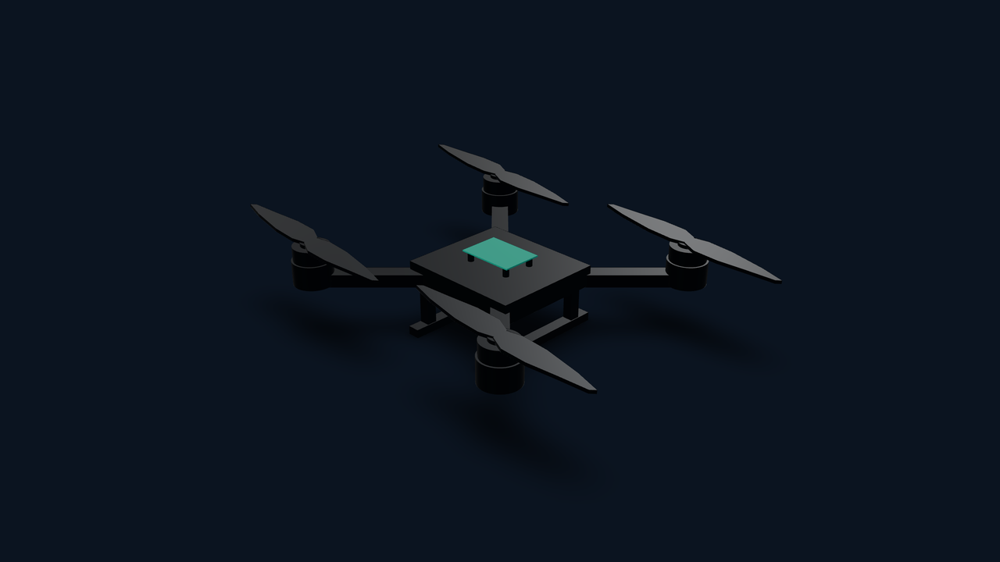
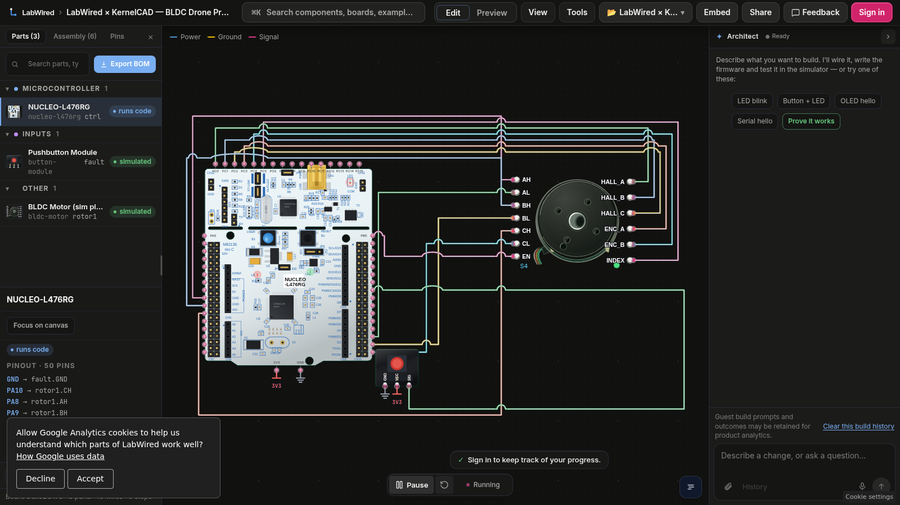

# Quadrotor propulsion: LabWired × KernelCAD

Rebuild a **modern ODrive-class motor-control function** from first principles: one verified STM32L476 BLDC propulsion channel in LabWired and an editable four-rotor drone concept in KernelCAD.

**This example does not run ODrive firmware or reproduce the proprietary modern ODrive PCB.** The firmware is a simple, inspectable **six-step commutator**, not field-oriented control. A quadcopter uses four propulsion channels: we verified **one** motor electronically, and modeled four rotors mechanically. The projects are linked by design intent, not yet by a shared live physics clock.

[**Watch the 35-second recorded demo (MP4)**](media/quadrotor-demo.mp4) — 1280×720 at 30 fps, H.264. Actual application footage, with no fabricated serial traces.

## Open the working projects

- **[Run the LabWired circuit and firmware](https://app.labwired.com/?share=15By9JQ39JOy&run=1)** — Cortex-M4, STM32 TIM1, one motor, inverter fault.
- **[View KernelCAD drone, revision 2](https://app.kernelcad.com/p/DyJ405zg?version=2)** — six named CAD bodies, four rotor revolute joints and a spin/stop animation timeline.
- [Original BLDC model and CI fault test in LabWired Core](https://github.com/w1ne/labwired-core/blob/main/examples/nucleo-l476rg-bldc/README.md).

## Verified behavior

| Test | Observed | Status |
| --- | --- | --- |
| Firmware compile | Hosted C compiler produced executable STM32L476 ELF | Pass |
| Model spin-up | Firmware emitted TARGET REACHED; measured peak absolute speed ≈ 6,190 RPM | **model_verified** |
| Inverter fault | SimInput fault.pressed=1 at cycle 1,250,000; firmware emitted FAULT DRIVER and INVERTER OFF | **model_verified** |
| Inverter gating | PB0 external inverter enable read LOW after the fault | **model_verified** |
| Mechanical CAD | Four revolute rotor mates; 13 poses checked; no collisions reported | **Motion checked** |
| Actual ODrive firmware / FOC | Not used; current-sense FOC and gate-driver IC not modeled | Not implemented |
| Propeller thrust and flight | No aerodynamic model or flight-control loop connected | Not verified |

These are *simulator-model results*, not tests of a real inverter, power stage, physical propeller or aircraft. Power-on and brownout are not modeled: the simulator assumes an ideal 3.3 V MCU rail.

## Real four-motor PCB and commercial propulsion parts

The actual hardware design is a separate, routed 4-in-1 **OpenESC** derivative,
not the STM32 single-axis simulator represented by this older recording:

- [Complete KiCad 10 ESC schematic/PCB and KiCad design rules](hardware/esc-4in1/)
- [Real-world four motor, propeller, frame, FC and battery wiring](hardware/assembly-wiring.md)
- [Complete system BOM, with manufacturer links and pending sourcing](hardware/system-bom.csv)
- [Native DRC, ERC and package-pad manufacturing review](hardware/esc-4in1/validation/README.md)

The complete motor power stage is **not** yet simulated in LabWired and the
physical PCB remains a review-only source until unresolved NC pad/DRC/ ERC
findings are corrected.

## Editable files

- [firmware/main.c](firmware/main.c) — compiled six-step STM32 firmware with TIM1 complementary PWM, Hall/encoder inputs, UART diagnostics and safe inverter-disable path.
- [labwired/circuit.json](labwired/circuit.json) — complete wiring: actual catalog IDs for STM32L476, bldc-motor and button-module.
- [labwired/evidence.json](labwired/evidence.json) — reproducible acceptance oracles, input stimuli, outcomes and limitations.
- [cad/drone.kcad.ts](cad/drone.kcad.ts) — parametric four-rotor design. Animation is visual only, **not** motor telemetry.
- [media/](media/) — screenshots captured from real Studio sessions.

## Electrical signals

| STM32L476 | Component pin | Role |
| --- | --- | --- |
| PA8/PB13 | BLDC AH/AL | Phase A main/complementary PWM |
| PA9/PB14 | BLDC BH/BL | Phase B main/complementary PWM |
| PA10/PB15 | BLDC CH/CL | Phase C main/complementary PWM |
| PB0 | BLDC ENABLE | External inverter enable |
| PC0–PC2 | BLDC HALL_A/B/C | Rotor Hall feedback |
| PC3–PC5 | BLDC ENC_A/B/INDEX | Quadrature feedback |
| PB7 | button-module SIG | Inject inverter fault |

The bldc-motor part is a **combined simulation plant**, not a manufacturable 13-pin BLDC device. A physical 24 V inverter needs gate driver, MOSFETs, current/voltage measurement, supply and thermal design.

## Reproduce tests through LabWired MCP

1. Use labwired_compile with the contents of firmware/main.c, board stm32l476, language c, entryPath src/main.c. Use the returned immutable firmware_ref.
2. Call labwired_verify with that reference, target stm32l476, and the JSON diagram. Require UART substring TARGET REACHED and motor rotor1 at least 100 RPM. Only successful model_verified counts.
3. In a separate call, drive input { component: fault, channel: pressed, value: 1, after_cycles: 1250000 } and require BOTH UART substrings FAULT DRIVER and INVERTER OFF plus GPIO PB0 == low. Confirm that the tool reports the stimulus actually applied; an undriven run is not fault proof.
4. Open the KernelCAD revision and review rotorCW / rotorCCW and per-part joints. The saved animation does not yet consume live LabWired RPM.

The public [LabWired Core firmware-in-loop model](https://github.com/w1ne/labwired-core/tree/main/examples/nucleo-l476rg-bldc) provides the independent reference. The example here is a compiled C adaptation.

## Technical roadmap

- Four independent motor plants, four firmware channels and unequal speed setpoints.
- Actual three-phase driver, MOSFET and current-sensor models and real field-oriented control.
- Verified propeller load coefficients, shaft inertia and a mechanical handoff to KernelCAD.
- Aerodynamic forces, flight dynamics and closed-loop attitude control.
- Recorded Studio footage showing the full hardware-to-motion workflow.

**Current status: model-verified single BLDC channel plus motion-checked drone geometry. Not flight-ready.**

## Recording provenance

The video uses genuine browser recordings from the real applications, not a generated visualization. The recorder and assembler are checked in:

- [media/capture.mjs](media/capture.mjs) captures the actual KernelCAD and LabWired browser interactions through Playwright's video recorder. Requires Node.js 22+, Playwright and Chrome.
- [media/render.sh](media/render.sh) trims the four clips and makes a captioned 1280×720 H.264 MP4 with FFmpeg. Only scene labels and title/end cards are added.

Reproduce from the repository root: install Playwright (npm install playwright), then execute the following commands from your shell:

    node examples/robotics/quadrotor-bldc/media/capture.mjs artifacts/quadrotor-video
    bash examples/robotics/quadrotor-bldc/media/render.sh artifacts/quadrotor-video examples/robotics/quadrotor-bldc/media/quadrotor-demo.mp4

The recording proves only the displayed application behavior. It is not physical flight validation or a live telemetry-driven CAD animation.
