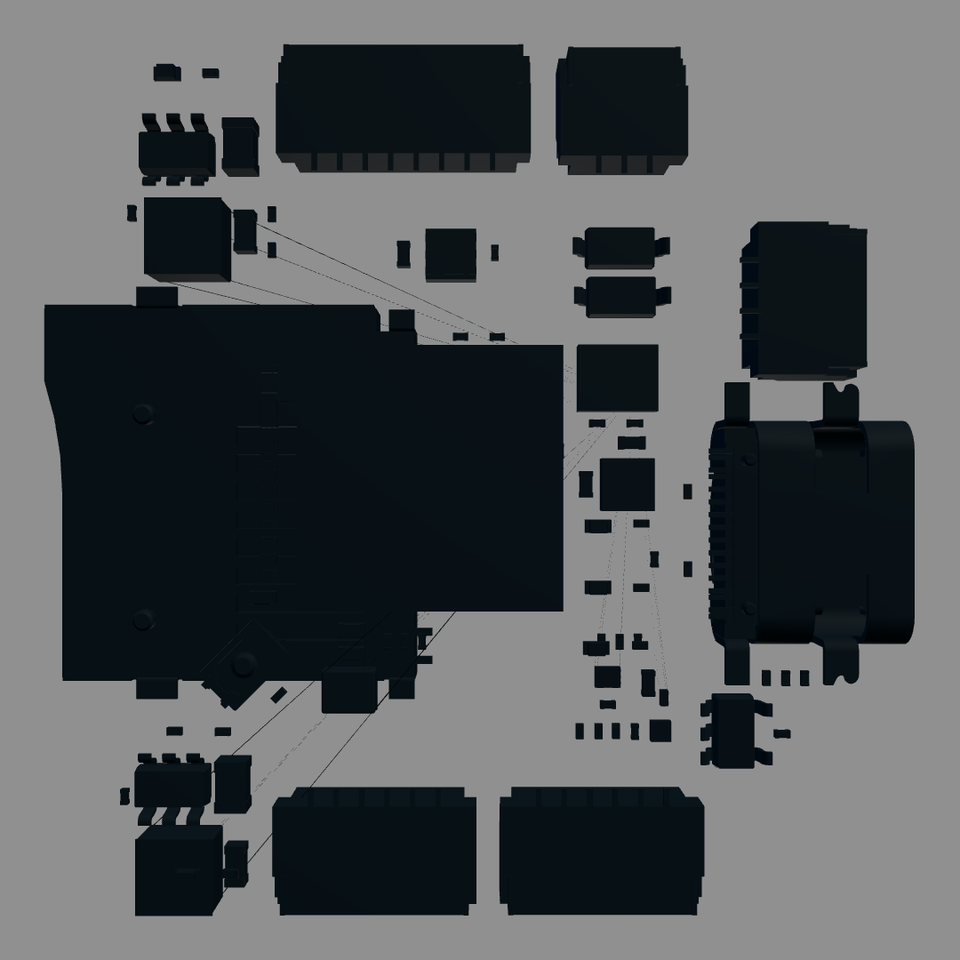
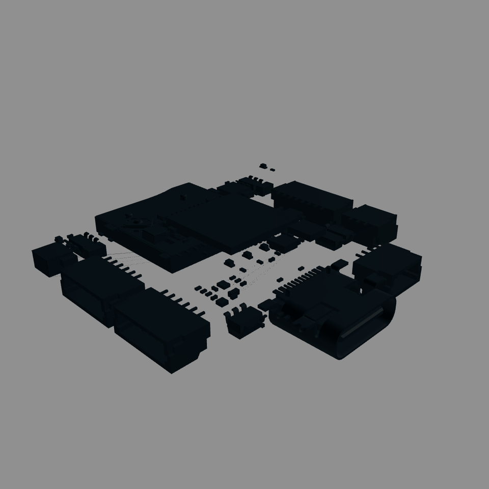

# Qualified stored CAD artifact — visual comparison

The existing local DemoPlayer rendered the archived and corrected FC population from the exact stored artifact bytes. The bounded capture produced four PNGs and an eight-second comparison video. All four original images and the complete corrected clip were visually inspected. All 192 video frames decode in sequence at 24 fps and 1920 × 1080.

The repaired artifact is the deployed DyJ405zg revision 6 result accepted in [the CAD correction record](../20261122-cad-correction/README.md). The model source, saved revision and assets are unchanged. The player loaded the recorded mesh directly; it did not evaluate CAD source or generate another mesh.

## Captured views

The clip presents four seconds of the top view followed by four seconds of the isometric view, with the predecessor on the left and the repaired artifact on the right. Both sides use the same camera bounds, material and light settings. It shows the FC population's 47,778 triangles, where exactly 28 incorrect indices were repaired.

[Eight-second comparison video](video/crease-corners-stored-artifacts.mp4)

| View | Predecessor artifact | Corrected deployed artifact |
| --- | --- | --- |
| Top |  |  |
| Isometric |  |  |

## Source and capture identity

The input artifact hashes are e041191cfd930893229d3d569dece43dc5ed8441dff865270f65e09b1f78e141 before repair and 166131d834781b76829ffa8d591da349e8c05b7a1206f2338c62cb73de748082 after repair. The latter came from the identical stored API and CDN downloads recorded in the correction bundle. The exact successful capture receipt binds both inputs, the reviewed geometry qualification, all 28 changed index positions and every PNG.

The renderer uses the existing production player, transfer and camera helpers from reviewed source 4aa581464aff2e09b8c2366fb1d166202e0e72d2, tree f879597f14fad52180a9655c5e8835c33256b41d, runtime fingerprint f00d5beda7bb1f5befa8f001329013b0c2b1e6b9ae85019837415deee2d89977. Its build recorded 700 input byte hashes. The 549 nondependency inputs were checked against 151 private overlay files and 398 files from the exact composed public base. Private source and the private renderer bundle are excluded from this public record.

The normal Playwright 1.58.0 launch used its pinned Chromium headless shell 145.0.7632.6, revision 1208, with a fresh temporary profile and no added GPU flags. The attempt finished in 10.056 seconds. Sampled aggregate peak memory was 995,000,320 bytes against a 2 GiB cap. All seven owned processes exited; no limit condition or cleanup signal was needed. Existing browser processes were not touched.

## Scope and preserved history

This is a local player comparison of actual stored artifacts. It is separate from a live hosted Studio viewer observation and from LabWired flight execution. The shipped-engine flight qualification, saved-project update and continuous Studio browser flight remain pending.

The earlier WebGL failures and false visual flags in the correction bundle remain unchanged. The encoder receipt was written before inspection and retains its original false inspection flag; the separate inspection receipt records the later complete review. The independent presentation review checks the image identity, caption correction and decoded frame sequence; it explicitly distinguishes that work from the separate full playback review. Public receipt projections replace only absolute workspace paths with descriptive placeholders and bind the original records by SHA-256.

The first encoded clip is preserved in prior/crease-corners-clipped-footer.mp4. Its footer touched the bottom edge. The final encoding changes only the caption and footer font sizes and y coordinates; all original PNGs and the raw capture receipt are byte-identical. Both final footer regions have five clear pixel rows below the text.

## Offline audit

Run `node audit.mjs` from this directory or invoke that file by its absolute path. The audit checks the published source/artifact bindings, four PNG identities, process limits and cleanup, exact encoder-only delta, both inspection receipts, video metadata and all 192 recorded decoded-frame checksums. It launches no browser and performs no CAD or flight execution. Normal examples CI invokes it through scripts/test_quadrotor_cad_visual.py.
